# Lumen Cards

**Beautiful, glass-style cards for your Home Assistant dashboard. Every card can be set up with clicks, no code needed.**

[Polski](README.pl.md)

<p align="center">
  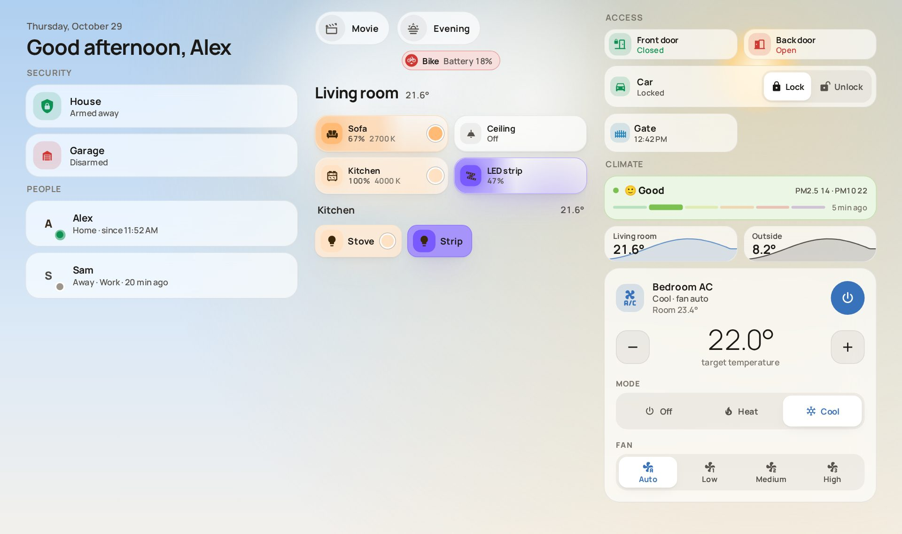<br>
  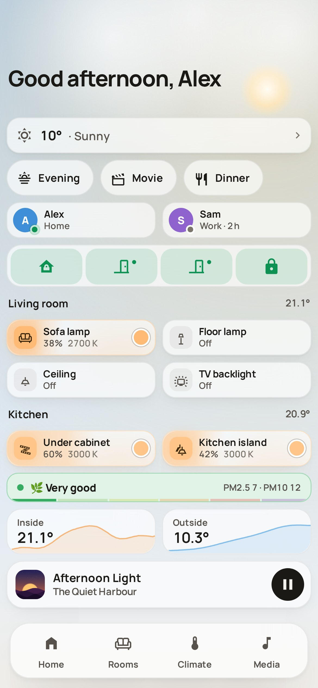
  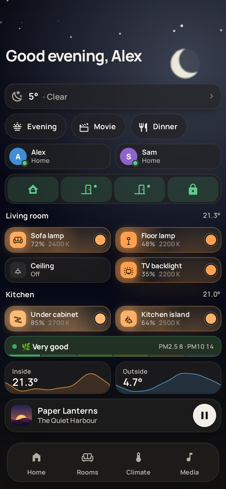
</p>

What you get:

- **Cards for the everyday things in a home:** lights, people, alarm, locks, doors, the gate, temperatures, air quality, the air conditioner and reminders.
- **Weather on the dashboard.** Rain, snow, fog or sunshine move behind the cards, and raindrops or snow settle on the cards themselves.
- **Big, comfortable controls.** Tap a light to switch it on, slide a finger across it to dim it, and hold it to pick the brightness and colour.
- **Phone and big screen.** A card squeezed into a small space turns into a compact square button.
- **Light and dark mode.** The cards follow your Home Assistant settings.
- **English and Polish.** The cards and their settings use the language from your Home Assistant profile.

---

## Contents

1. [Install](#install)
2. [Add your first card](#add-your-first-card)
3. [The cards](#the-cards)
4. [Example dashboards](#example-dashboards)
5. [Settings of every card](#settings-of-every-card)
6. [Questions and problems](#questions-and-problems)
7. [For developers](#for-developers)

---

## Install

You need **Home Assistant 2026.6 or newer** and **[HACS](https://hacs.xyz/)** (the community store for Home Assistant add-ons).

1. Open **HACS** in the Home Assistant sidebar.
2. Click the **⋮** menu (top right) and choose **Custom repositories**.
3. Paste `https://github.com/dkej123/lumen-cards`, choose the type **Dashboard**, and click **Add**.
4. Search HACS for **Lumen Cards**, open it and click **Download**.
5. **Refresh your browser** (on a computer press Ctrl+F5, or Cmd+Shift+R on a Mac). In the Home Assistant phone app, open **Settings → Companion app → Debugging → Reset frontend cache**.

That's it. HACS tells Home Assistant about the new cards by itself.

<details>
<summary>Installing without HACS</summary>

1. Download the latest release from the Releases page, or the files in the `dist/` folder: `lumen-cards.js` and all the `.woff2` font files.
2. Copy them into the folder `config/www/lumen-cards/` on your Home Assistant.
3. Go to **Settings → Dashboards → ⋮ → Resources → Add resource**, enter `/local/lumen-cards/lumen-cards.js` and choose **JavaScript module**.
4. Refresh the browser.
</details>

## Add your first card

1. Open a dashboard and click the **pencil** (top right) to edit it.
2. Click **+ Add card**.
3. Type **Lumen** in the search box. You will see all the Lumen cards with a live preview.
   You can also go to the **By entity** tab and pick a device, for example a light. Lumen will suggest the right card for it.
4. Pick a card. A settings window opens. Choose your device in the first field and the preview updates straight away.
5. Click **Save**.

Every setting has a field in this window. You never have to write code.

> **Tip:** to make a card bigger or smaller, drag its corner while the dashboard is in edit mode. A narrow card switches to its compact look on its own.

---

## The cards

### Light

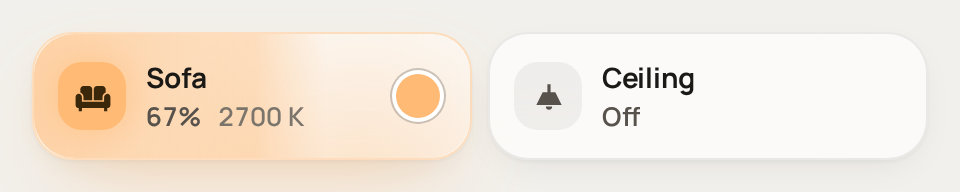<br>
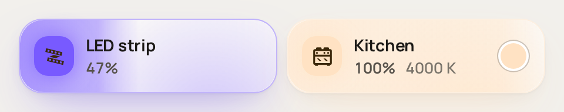<br>
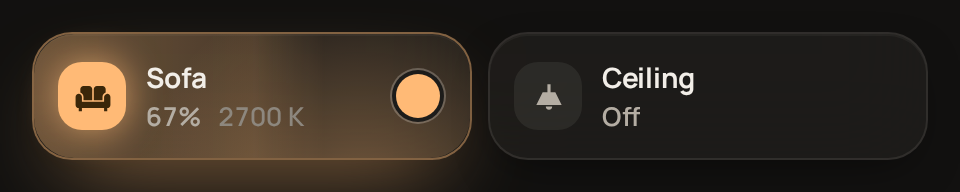

A large tile for one light. The tile glows in the colour of the bulb.

- **Tap** to switch it on or off.
- **Slide your finger** left or right across the tile to dim it.
- **Tap the small circle** to choose a warmer or cooler white.
- **Hold** to open the full controls: brightness, white tone, and colours for colour bulbs.

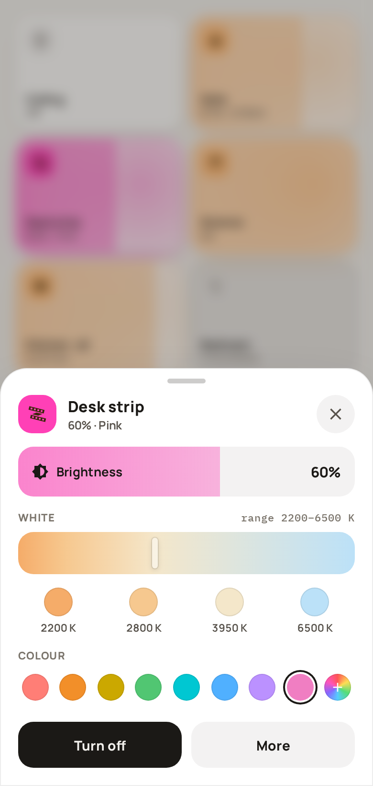

### Chips

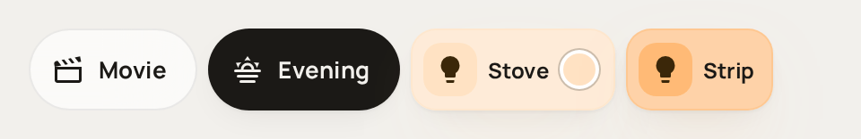

A row of small round buttons. They come in two kinds:

- **Action:** runs a scene, script or button with one tap, for example "Movie" or "Evening".
- **Light:** a small pill for a light, which works like the light card.

On a phone you can turn the action chips into a **floating button** in the corner of the screen (see [Climate](#climate) for a picture).

### Person

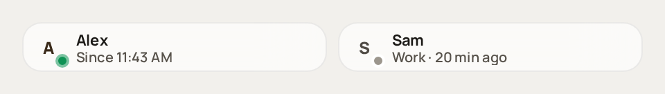

Shows a household member: their photo (or initial), a **green dot when they are home**, and how long they have been home or away. When they are away, it shows where, for example "Work".

### Alarm

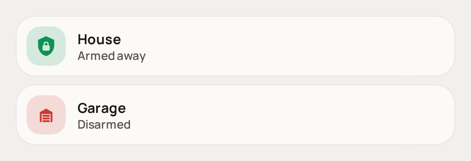

Shows your alarm at a glance: green when it is armed, red when it is disarmed. When the alarm goes off, a red banner appears and the whole screen pulses red:

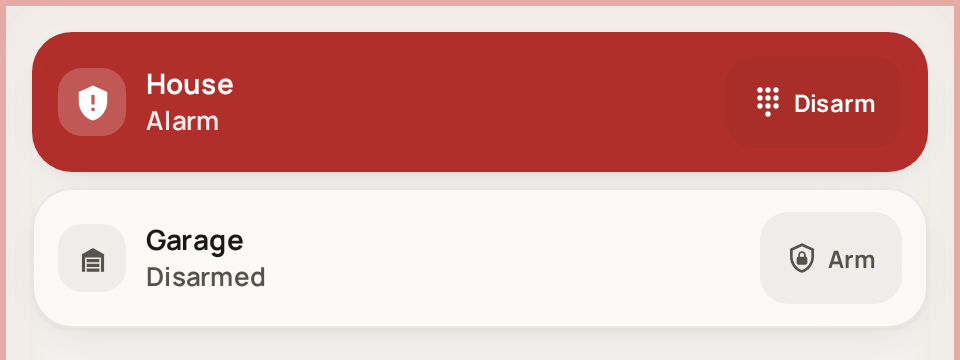

You decide what a tap does, for example run your "arm / disarm" script.

### Lock

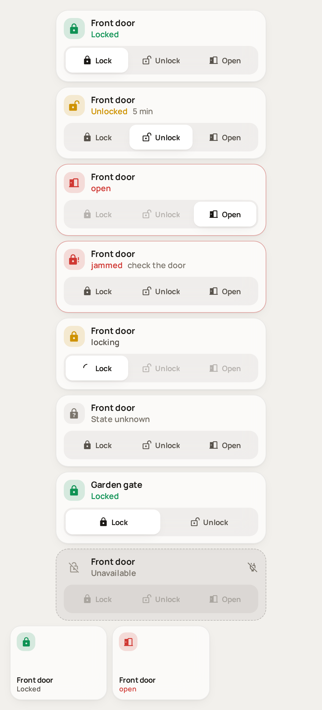

Shows whether a lock is locked, with **Lock** and **Unlock** buttons (and **Open** if the lock can open the door). If the lock needs a PIN, a keypad appears first:

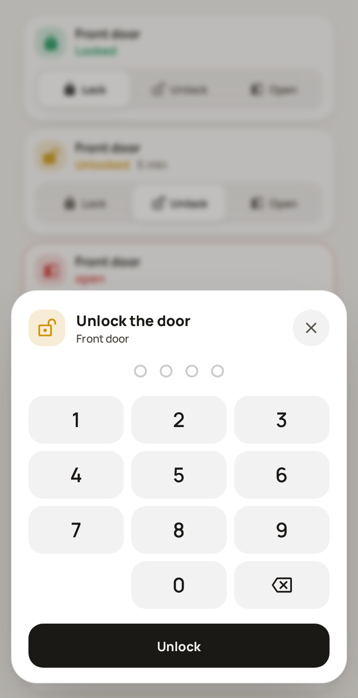

### Entity (door, window…)

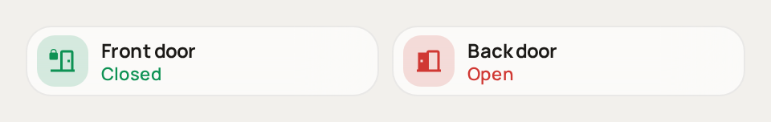

A small tile for anything with a state. Doors and windows turn **red when open**. On a phone the card can become a small square button.

### Button

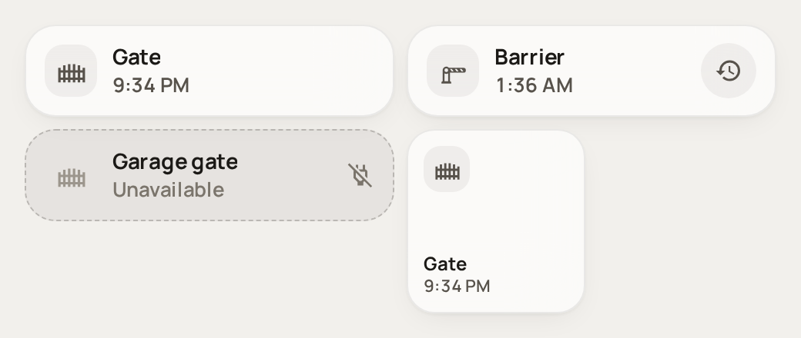

Runs something with one tap: a script, a scene, a button. It can also **wait for an answer** from the device, for example a gate that reports whether it really opened, and then shows "Gate opened" or the error.

The small round button on the right is an **extra button** (`sub_buttons`). You can add them to several cards, for example to switch a nearby light.

### Sensor

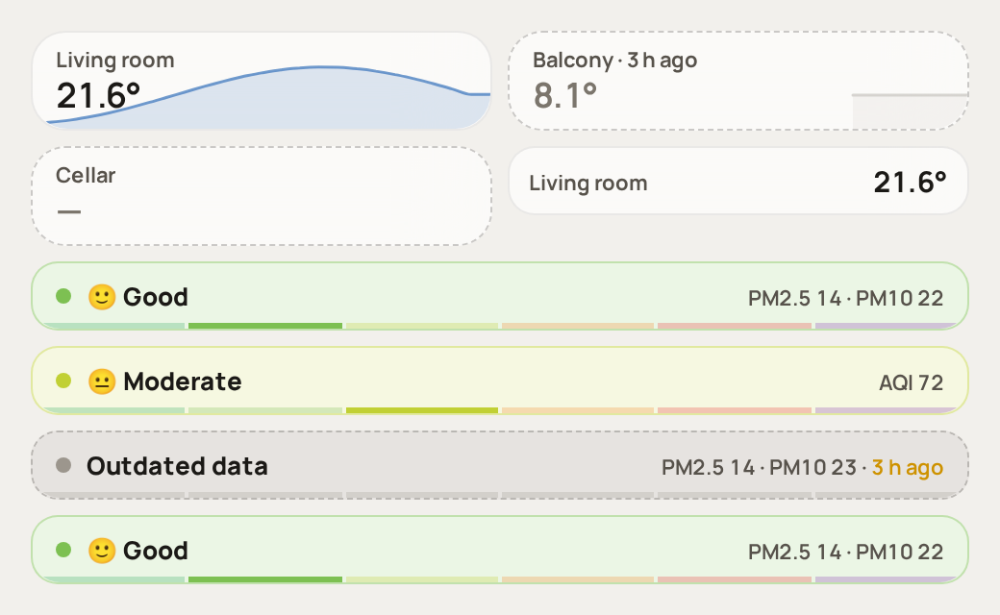

A temperature (or any other number) with a small chart of the last hours behind it. Tap to see the full history.

### Climate

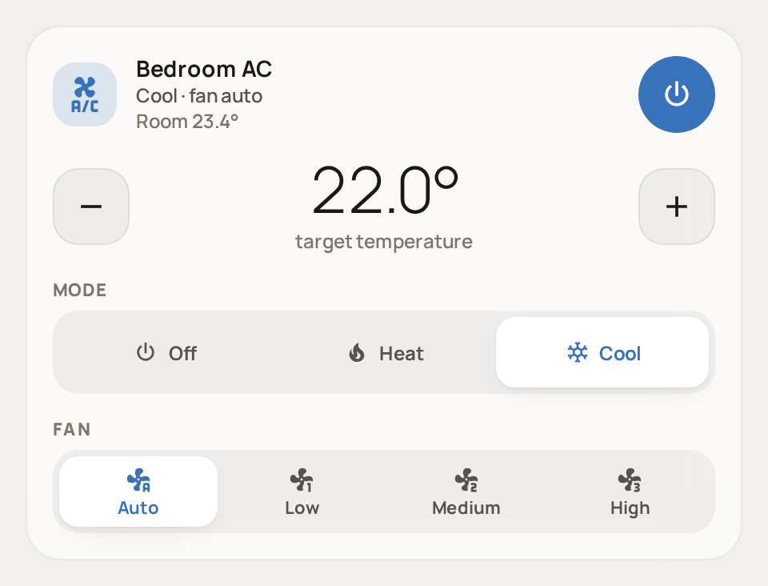

For an air conditioner or a thermostat: the target temperature with **−** and **+**, the mode (off / heat / cool) and the fan speed.

On a phone it can shrink to a **floating round button** that shows the temperature. Tap it to open the controls, or hold it to switch the device on or off:

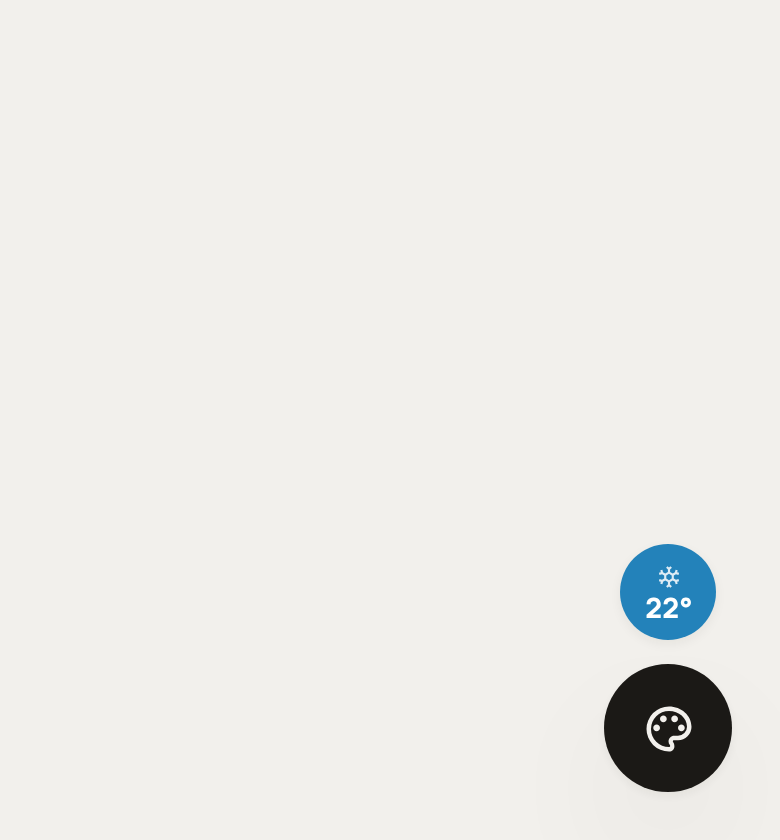
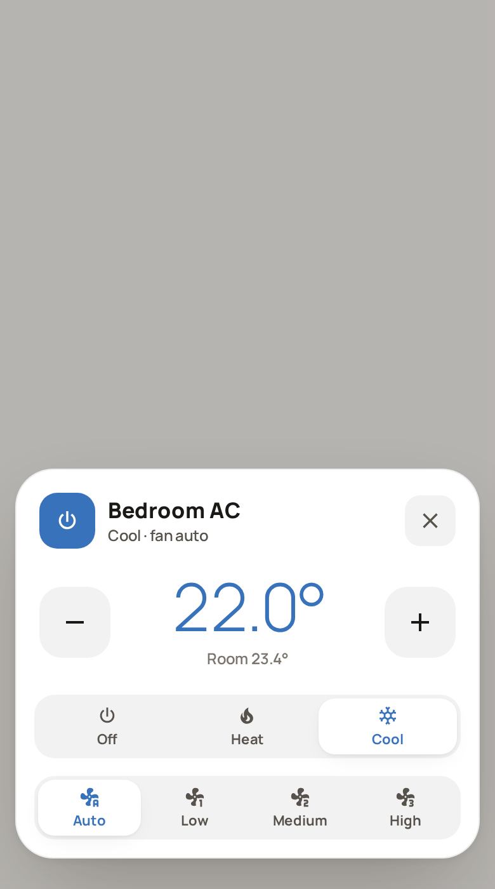

### Air quality

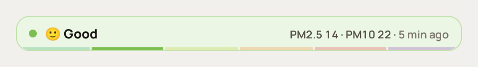

Turns PM2.5 / PM10 (or an AQI sensor) into six easy levels, from "Very good" to "Extremely poor", using the European Air Quality Index. Tap it for a 24-hour chart. If the sensor stops sending data, the card shows a dashed border and "Outdated data".

### Reminder

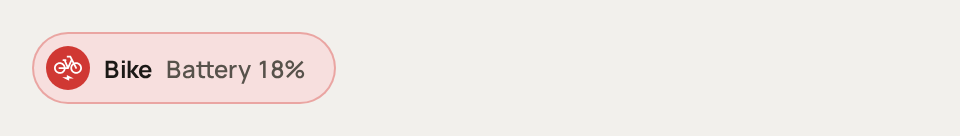

A small pill that appears **only when something needs attention**, for example "Bike – battery 18 %". It can also pop up a window when it starts, and again every time you open the dashboard, until you tap **Done**:

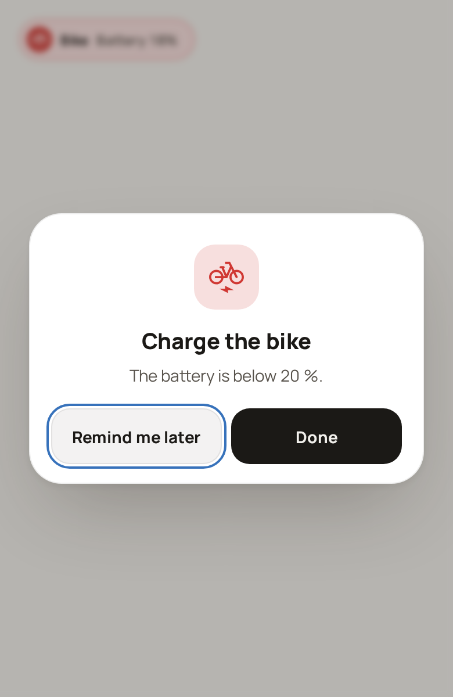

### Title

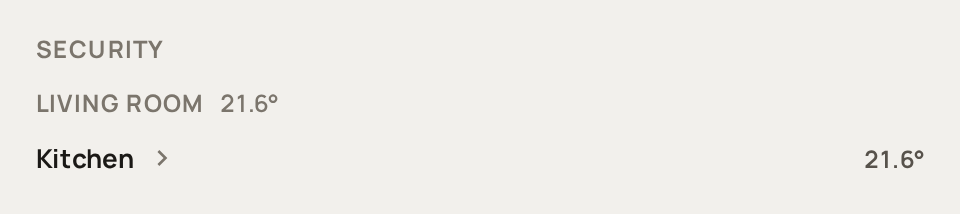

Headings that split your dashboard into parts, in three styles: a small caps label, a large section title, or a room header. A heading can show values next to it, like the room temperature.

### Greeting

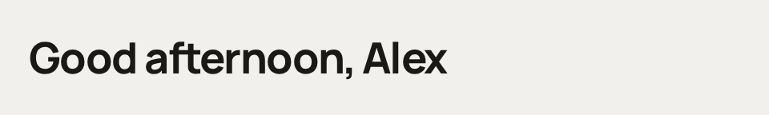

"Good morning / Good afternoon / Good evening" with the name of whoever is logged in, and today's date.

### Weather background

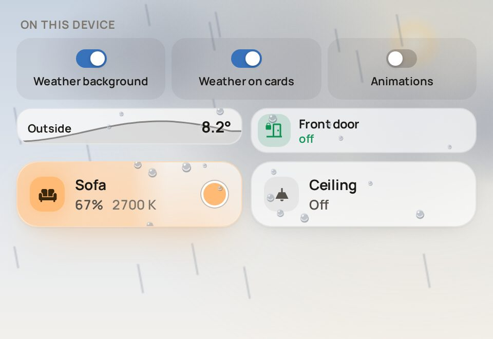
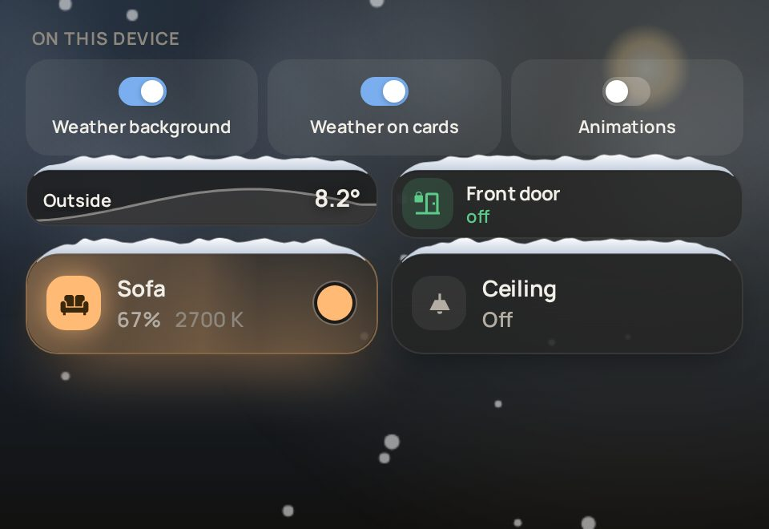

Add this card **once per dashboard view** and the sky behind your cards follows the real weather: sun, clouds, rain, snow, fog, wind and lightning, by day and by night. Raindrops and snow also appear on the other Lumen cards.

The card itself takes no space. If you like, it can show three switches so each device decides for itself: background on/off, weather on cards on/off, animations on/off. That is handy for an old tablet.

---

## Example dashboards

The two dashboards at the top of this page. To use one:

1. Create a new dashboard: **Settings → Dashboards → + Add dashboard → New dashboard from scratch**.
2. Open it, click the **pencil**, then **⋮ → Raw configuration editor**.
3. Delete everything there, paste the example and click **Save**.
4. **Replace the example devices with your own.** For example, change `light.sofa` to the name of your light. You can also do this later card by card with the pencil.

<details>
<summary><b>Phone dashboard</b> (one column)</summary>

```yaml
views:
  - title: Home
    type: sections
    max_columns: 1
    sections:
      - type: grid
        cards:
          - type: custom:lumen-weather-background-card
            weather_entity: weather.home
          - type: custom:lumen-greeting-card
          # four small square buttons in one row
          - type: custom:lumen-alarm-card
            entity: alarm_control_panel.house
            grid_options: { columns: 3 }
          - type: custom:lumen-alarm-card
            entity: alarm_control_panel.garage
            icon: mdi:garage
            grid_options: { columns: 3 }
          - type: custom:lumen-entity-card
            entity: binary_sensor.front_door
            grid_options: { columns: 3 }
          - type: custom:lumen-lock-card
            entity: lock.car
            icon: mdi:car
            grid_options: { columns: 3 }
          - type: custom:lumen-person-card
            entity: person.alex
            grid_options: { columns: 6 }
          - type: custom:lumen-person-card
            entity: person.sam
            grid_options: { columns: 6 }
          - type: custom:lumen-reminder-card
            entity: input_boolean.bike_battery
            name: Bike
            icon: mdi:bicycle-electric
            color: danger
            value: "Battery {value}%"
            value_entity: sensor.bike_battery
            title: Charge the bike
            message: The battery is below 20 %.
            done: true
            alignment: center
          - type: custom:lumen-title-card
            title: Living room
            heading_style: section
            badges: [sensor.living_temp]
          - type: custom:lumen-light-card
            entity: light.sofa
            icon: mdi:sofa
            grid_options: { columns: 6 }
          - type: custom:lumen-light-card
            entity: light.ceiling
            icon: mdi:ceiling-light
            grid_options: { columns: 6 }
          - type: custom:lumen-light-card
            entity: light.kitchen
            icon: mdi:stove
            grid_options: { columns: 6 }
          - type: custom:lumen-light-card
            entity: light.strip
            icon: mdi:led-strip-variant
            grid_options: { columns: 6 }
          - type: custom:lumen-air-quality-card
            pm25: sensor.pm25
            pm10: sensor.pm10
          - type: custom:lumen-sensor-card
            entity: sensor.living_temp
            grid_options: { columns: 6 }
          - type: custom:lumen-sensor-card
            entity: sensor.outside_temp
            color: light-blue
            grid_options: { columns: 6 }
          # these two become floating buttons in the corner
          - type: custom:lumen-chips-card
            fab: true
            chips:
              - { type: action, entity: scene.movie }
              - { type: action, entity: scene.evening }
          - type: custom:lumen-climate-card
            entity: climate.bedroom_ac
            fab: true
```
</details>

<details>
<summary><b>Tablet / desktop dashboard</b> (three columns)</summary>

```yaml
views:
  - title: Home
    type: sections
    max_columns: 3
    sections:
      - type: grid
        cards:
          - type: custom:lumen-weather-background-card
            weather_entity: weather.home
          - type: custom:lumen-greeting-card
          - type: custom:lumen-title-card
            title: Security
          - type: custom:lumen-alarm-card
            entity: alarm_control_panel.house
          - type: custom:lumen-alarm-card
            entity: alarm_control_panel.garage
            icon: mdi:garage
          - type: custom:lumen-title-card
            title: People
          - type: custom:lumen-person-card
            entity: person.alex
          - type: custom:lumen-person-card
            entity: person.sam
      - type: grid
        cards:
          - type: custom:lumen-chips-card
            chips:
              - { type: action, entity: scene.movie }
              - { type: action, entity: scene.evening }
          - type: custom:lumen-reminder-card
            entity: input_boolean.bike_battery
            name: Bike
            icon: mdi:bicycle-electric
            color: danger
            value: "Battery {value}%"
            value_entity: sensor.bike_battery
            done: true
            alignment: center
          - type: custom:lumen-title-card
            title: Living room
            heading_style: section
            badges: [sensor.living_temp]
          - type: custom:lumen-light-card
            entity: light.sofa
            icon: mdi:sofa
            grid_options: { columns: 6 }
          - type: custom:lumen-light-card
            entity: light.ceiling
            icon: mdi:ceiling-light
            grid_options: { columns: 6 }
          - type: custom:lumen-light-card
            entity: light.kitchen
            icon: mdi:stove
            grid_options: { columns: 6 }
          - type: custom:lumen-light-card
            entity: light.strip
            icon: mdi:led-strip-variant
            grid_options: { columns: 6 }
          - type: custom:lumen-title-card
            title: Kitchen
            heading_style: room
            badges: [sensor.living_temp]
          - type: custom:lumen-chips-card
            chips:
              - { type: light, entity: light.kitchen, name: Stove }
              - { type: light, entity: light.strip, name: Strip }
      - type: grid
        cards:
          - type: custom:lumen-title-card
            title: Access
          - type: custom:lumen-entity-card
            entity: binary_sensor.front_door
            grid_options: { columns: 6 }
          - type: custom:lumen-entity-card
            entity: binary_sensor.back_door
            grid_options: { columns: 6 }
          - type: custom:lumen-lock-card
            entity: lock.car
            icon: mdi:car
          - type: custom:lumen-button-card
            entity: script.gate
            icon: mdi:gate
            grid_options: { columns: 6 }
          - type: custom:lumen-title-card
            title: Climate
          - type: custom:lumen-air-quality-card
            pm25: sensor.pm25
            pm10: sensor.pm10
          - type: custom:lumen-sensor-card
            entity: sensor.living_temp
            grid_options: { columns: 6 }
          - type: custom:lumen-sensor-card
            entity: sensor.outside_temp
            color: light-blue
            grid_options: { columns: 6 }
          - type: custom:lumen-climate-card
            entity: climate.bedroom_ac
```
</details>

> **One dashboard for both phone and tablet?** Yes. Add a card twice: once small (for example 3 columns wide) shown only on phones, and once big shown only on large screens. In the card editor, open the **Visibility** tab → **Add condition** → **Screen** and tick the screen sizes. Home Assistant hides the other copy for you.

---

## Settings of every card

You can change all of these in the card editor. The names in `code font` are what you see in YAML, if you ever look there.

### Settings that every card has

You find them under **Appearance** and **Advanced** at the bottom of the editor.

| Setting | What it does | Default |
|---|---|---|
| `layout` | **Auto** picks the look by itself: compact when the card is small. **Full** or **Compact** forces one look. | Auto |
| `color_scheme` | Light or dark card, or **Auto** to follow Home Assistant | Auto |
| `accent_color` | Colour of buttons and highlights | from the theme |
| `glow_color` | Colour of the glow around lit lights (light and chips cards) | the light's own colour |
| `weather_effects` | Raindrops, snow and so on drawn on this card. Needs the weather background card in the same view. | on |
| `max_width` | The card is never wider than this many pixels and stays centred in its place. Handy in a Panel view or very wide sections; in a normal sections view the columns already keep cards narrow. | full width |
| `tap_action`, `hold_action`, `double_tap_action` | What happens when you tap, hold or double-tap: switch, show details, open another page, run a script… | depends on the card |
| `sub_buttons` | Small extra round buttons on the right of the card, each with its own device and action. Available on entity, button, person and alarm cards. | none |
| `styles` | For tinkerers: your own CSS inside the card | none |

<a id="lumen-light-card"></a>

### Light (`lumen-light-card`)

| Setting | What it does | Default |
|---|---|---|
| `entity` | The light | – |
| `name`, `icon` | Name and icon on the tile | from the device |
| `power_entity` | The wall switch or relay that powers the bulb. When it is off the bulb is "off", not "unavailable", and a tap switches the relay. | none |
| `show_state` | Show the brightness line | on |
| `show_color_button` | Show the small white-tone circle | on |

<a id="lumen-chips-card"></a>

### Chips (`lumen-chips-card`)

| Setting | What it does | Default |
|---|---|---|
| `chips` | The list of chips. Each one has a `type`: **action** (scene, script, button…) or **light**. Each also has an `entity`, and optionally a `name`, `icon` and `tap_action`. Light chips can have a `power_entity`. | – |
| `alignment` | Left, centre, right or spread out | left |
| `fab` | **Show as a floating button**: the action chips move into a round button in the bottom-right corner | off |
| `fab_narrow_only` | **Auto: only on narrow screens.** The floating button appears only on phones and portrait tablets; on wider screens the normal row stays. Untick to always use the floating button. | on |
| `title` | Heading above the items of the floating button | "Scenes" |

<a id="lumen-person-card"></a>

### Person (`lumen-person-card`)

| Setting | What it does | Default |
|---|---|---|
| `entity` | The person | – |
| `presence_entity` | A sensor that knows best whether they are home, for example a Bluetooth tag. Without it the person's home zone is used. | none |
| `name` | Name shown | from the person |
| `picture` | Address (URL) of a photo | the person's photo |
| `avatar_color` | Background colour behind the initial when there is no photo | peach |
| `show_name`, `show_status` | Show the name / the "home since…" line | on |

<a id="lumen-alarm-card"></a>

### Alarm (`lumen-alarm-card`)

| Setting | What it does | Default |
|---|---|---|
| `entity` | The alarm panel | – |
| `name`, `icon` | Name, and an icon instead of the shield (for example a garage) | from the device |
| `banner` | Red banner when the alarm goes off | on |
| `banner_text` | Text of the banner | "Alarm: *name*!" |
| `screen_ring` | Red pulsing frame around the whole screen when the alarm goes off | on |
| `show_state` | Show the state line | on |

Tip: set `tap_action` to your arm/disarm script so one tap switches the alarm.

<a id="lumen-lock-card"></a>

### Lock (`lumen-lock-card`)

| Setting | What it does | Default |
|---|---|---|
| `entity` | The lock | – |
| `name`, `icon` | Name and icon | from the device |
| `busy_entity` | A sensor that is "on" while the lock is working (some car locks take a while). The card waits for it to finish before saying "done". | none |
| `show_state` | Show the state line | on |

<a id="lumen-entity-card"></a>

### Entity (`lumen-entity-card`)

| Setting | What it does | Default |
|---|---|---|
| `entity` | Any device or sensor | – |
| `name`, `icon` | Name and icon | from the device |
| `show_name`, `show_icon`, `show_state` | Show or hide each part | on |

<a id="lumen-button-card"></a>

### Button (`lumen-button-card`)

| Setting | What it does | Default |
|---|---|---|
| `entity` | What the button runs: a script, scene, button, or anything that can be switched | – |
| `name`, `icon` | Name and icon | from the device |
| `feedback` | **Wait for the device's answer** after a tap. Fill in `status_entity` (the sensor with the answer code), `success_state` (the code that means success), `message_entity` (the sensor with the error text) and `success_text` (what to show on success). | off |
| `last_used_entity` | A date-and-time helper that stores when it was last used | none |
| `secondary_info` | Second line: **Auto** (last use), state, last run, last change, or nothing | Auto |
| `show_name`, `show_icon`, `show_state` | Show or hide each part | on |

`success_state` defaults to `"200"`.

<a id="lumen-sensor-card"></a>

### Sensor (`lumen-sensor-card`)

| Setting | What it does | Default |
|---|---|---|
| `entity` | The sensor | – |
| `name` | Name shown | from the sensor |
| `hours` | How many hours the chart covers | 12 |
| `color` | Colour of the chart | accent colour |
| `show_name`, `show_graph` | Show the name / the chart | on |

<a id="lumen-climate-card"></a>

### Climate (`lumen-climate-card`)

| Setting | What it does | Default |
|---|---|---|
| `entity` | The air conditioner or thermostat | – |
| `name`, `icon` | Name and icon | from the device |
| `hvac_modes` | Which mode buttons to show | off, heat, cool |
| `fan_modes` | Which fan buttons to show | auto, low, medium, high |
| `min_temp`, `max_temp` | Narrow the temperature range (empty = the device's own range) | the device's |
| `fab` | **Show as a floating button** in the corner | off |
| `fab_narrow_only` | **Auto: only on narrow screens**: floating button on phones, normal card on big screens | on |
| `power_action` | What the power button does, if you want your own script instead | turns on the last used mode / turns off |
| `show_current_temp`, `show_modes`, `show_fan_modes` | Show the room temperature / the mode buttons / the fan buttons | on |

Only the modes your device really has are shown. Thermostats with a "from–to" range work too: tap the lower or upper number to choose which one **−** and **+** change.

<a id="lumen-air-quality-card"></a>

### Air quality (`lumen-air-quality-card`)

| Setting | What it does | Default |
|---|---|---|
| `pm25`, `pm10`, `aqi_entity` | Your air sensors. One of the three is enough. | – |
| `stale_hours` | After how many hours without new data the card says "Outdated data" | 1 |
| `footer` | A short note at the bottom of the chart window, for example "Sensor on the balcony" | none |
| `levels` | Your own names for the six levels (YAML only) | Very good … Extremely poor |
| `show_values`, `show_bar` | Show the numbers / the coloured level bar | on |

<a id="lumen-reminder-card"></a>

### Reminder (`lumen-reminder-card`)

| Setting | What it does | Default |
|---|---|---|
| `entity` | The thing to watch, for example a toggle helper "bike battery low" | – |
| `state` | The reminder is active while the device has this state | `on` |
| `name`, `icon`, `color` | Label, icon and colour (info, ok, warning, danger) of the pill | from the device, info |
| `value`, `value_entity` | Extra text on the pill; `{value}` is replaced with the number from `value_entity`, for example "Battery {value}%" | none |
| `show_chip` | Show the pill at all (off = only the pop-up window) | on |
| `dialog` | Pop up a window when the reminder starts | on |
| `title`, `message` | Heading and text of the window | the name |
| `done` | Show a **Done** button that switches the reminder off | off |
| `done_action` | Something else for **Done** to do instead | switch off |
| `alignment` | Where the pill sits: left, centre or right | left |

<a id="lumen-title-card"></a>

### Title (`lumen-title-card`)

| Setting | What it does | Default |
|---|---|---|
| `title` | The text | – |
| `heading_style` | **Overline** (small capitals), **Section title** (large) or **Room header** | Overline |
| `badges` | Values shown next to the title. Each has an `entity`, and optionally `state_content` (an attribute to show instead of the state) and `name` (a label before the value). | none |
| `entity`, `tap_action` | What tapping the title opens | nothing |

<a id="lumen-greeting-card"></a>

### Greeting (`lumen-greeting-card`)

| Setting | What it does | Default |
|---|---|---|
| `show_date` | Show today's date above the greeting | on |
| `name` | Name after the greeting | the logged-in user |
| `sun_entity` | Sun sensor used to tell morning from evening | `sun.sun` |

<a id="lumen-weather-background-card"></a>

### Weather background (`lumen-weather-background-card`)

| Setting | What it does | Default |
|---|---|---|
| `weather_entity` | Your weather forecast device | – |
| `sun_entity` | Sun sensor for day and night | `sun.sun` |
| `show_controls` | Show the three switches: weather background, weather on cards, animations. Each device remembers its own choice. | off |

---

## Questions and problems

**I installed it but can't find the cards.**
Refresh the browser with Ctrl+F5 (Cmd+Shift+R on a Mac). In the phone app, use **Settings → Companion app → Debugging → Reset frontend cache**. Then search for "Lumen" when adding a card.

**I see "Custom element doesn't exist: lumen-…".**
Same fix: refresh the browser. If it is still there, check **Settings → Dashboards → ⋮ → Resources**. There should be one entry ending in `lumen-cards.js`.

**There is no rain or snow on my dashboard.**
Add the **Weather background** card to the same view (one per view is enough), and choose your weather device in it. Some old tablets turn effects off to save power. Turn on `show_controls` to see the switches.

**The cards look different on my phone and on my tablet.**
That's on purpose: a small card shows its compact look. To decide exactly what appears where, see the tip under [Example dashboards](#example-dashboards) (two copies plus the **Screen** visibility condition). You can also set `layout` to **Full** or **Compact** to stop the automatic switching.

**My air conditioner's floating button covers something.**
Two floating buttons stack on top of each other automatically. To move them up, for example above a bottom navigation bar, add `lumen-cards-fab-bottom: 90px` to your Home Assistant theme.

**Can I change the colours?**
Yes: `accent_color` and `glow_color` on each card, or for all cards at once with `lumen-cards-accent` and `lumen-cards-glow-color` in a Home Assistant theme.

**Can I use it with a keyboard?**
Yes. Tab moves between cards. Enter or Space taps. Shift+Enter holds (for example to open the light panel). The arrow keys change brightness, and Escape closes windows.

---

## For developers

```sh
npm install
npm run dev     # demo with made-up devices: http://localhost:5174/dev/index.html
npm test
npm run build   # → dist/
```

Demo options: `?compact`, `&dark`, `&lang=pl`, `&fx` (weather), `&weather=snowy`, `&scene=phone|desktop`, `&only=<card>`. Texts live in `src/translations/en.json` and `pl.json`. To add a language, add a file and register it in `src/core/i18n.ts`.

## License

MIT. Fonts: Manrope and IBM Plex Mono (SIL Open Font License), via Fontsource.
