# Lumen Cards

**Ładne, „szklane” karty do dashboardu Home Assistant. Każdą kartę ustawisz klikając, bez pisania kodu.**

[English](README.md)

<p align="center">
  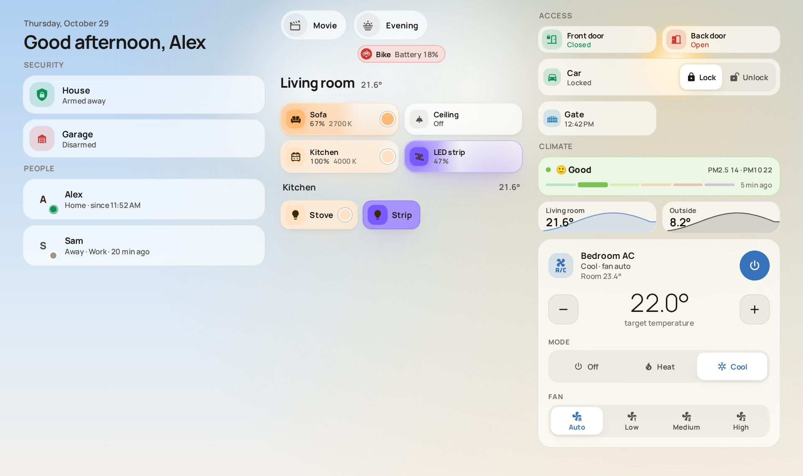<br>
  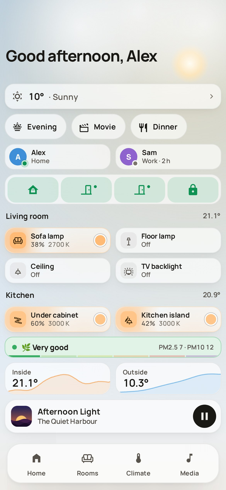
  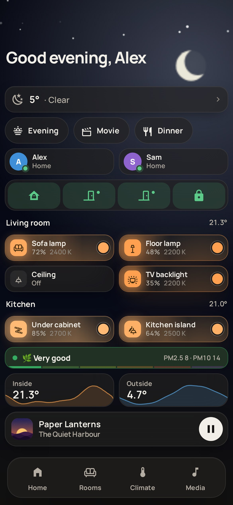
</p>

Co dostajesz:

- **Karty na codzienne sprawy w domu:** światła, domownicy, alarm, zamki, drzwi, brama, temperatury, jakość powietrza, klimatyzacja, przypomnienia, rolety, muzyka, wentylatory, listy wyboru, kalendarze, pasek nawigacji i pop-upy.
- **Pogoda na dashboardzie.** Za kartami pada deszcz, sypie śnieg, snuje się mgła albo świeci słońce, a krople i śnieg osiadają też na samych kartach.
- **Duże, wygodne przyciski.** Światło włączasz dotknięciem, ściemniasz przesuwając po nim palcem, a przytrzymanie otwiera jasność i kolor.
- **Telefon i duży ekran.** Karta wciśnięta w małe miejsce sama zamienia się w niski kompaktowy kafel (44 px, równy w wierszu).
- **Tryb jasny i ciemny.** Karty dopasowują się do ustawień Home Assistant.
- **Po polsku i po angielsku.** Język kart i ich ustawień jest brany z Twojego profilu w Home Assistant.

### Tak to wygląda w prawdziwym domu

Dashboard autora wieczorem, w trybie ciemnym. Na komputerze wersja zbudowana z Lumen Cards. Na telefonie panel „Dom”, z którego powstały Lumen Cards (karty wyglądają tak samo):

<p align="center">
  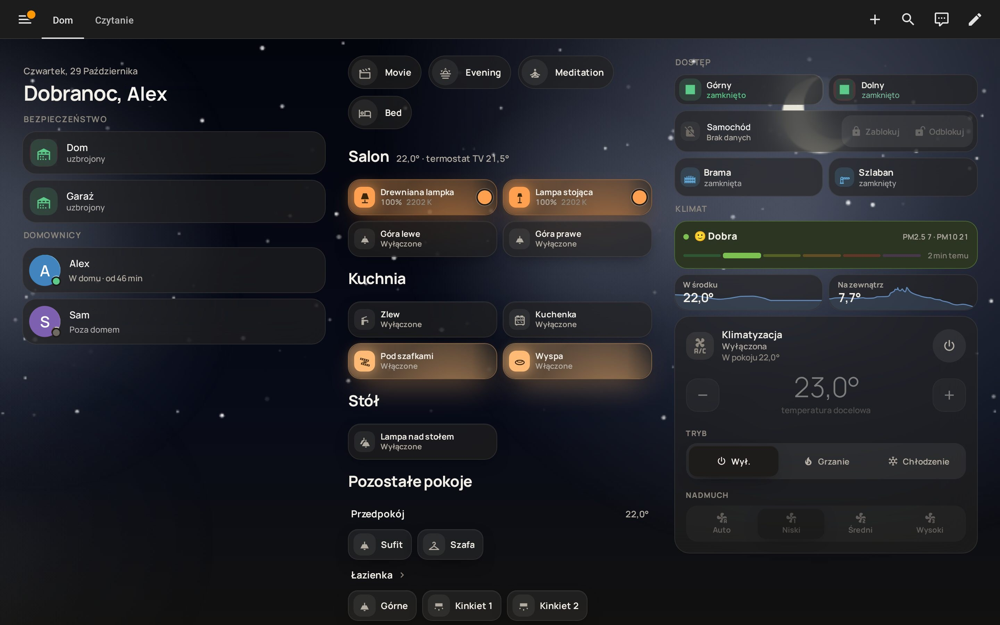<br>
  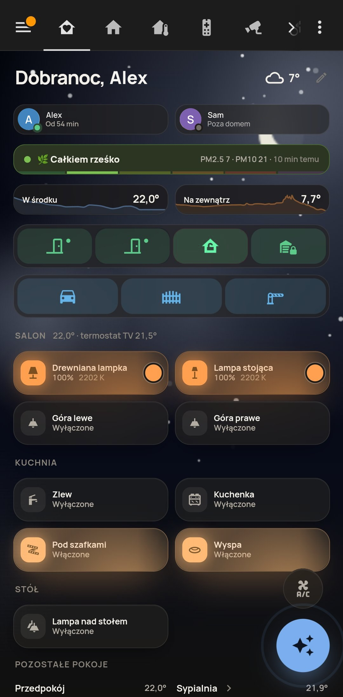
</p>

---

## Spis treści

1. [Instalacja](#instalacja)
2. [Pierwsza karta](#pierwsza-karta)
3. [Karty](#karty)
4. [Przykładowe dashboardy](#przykładowe-dashboardy)
5. [Ustawienia kart](#ustawienia-kart)
6. [Pytania i problemy](#pytania-i-problemy)
7. [Dla programistów](#dla-programistów)

---

## Instalacja

Potrzebujesz **Home Assistant 2026.6 lub nowszego** i **[HACS](https://hacs.xyz/)**, czyli sklepu z dodatkami społeczności.

1. Otwórz **HACS** w bocznym menu Home Assistant.
2. Kliknij menu **⋮** w prawym górnym rogu i wybierz **Custom repositories**.
3. Wklej `https://github.com/dkej123/lumen-cards`, wybierz typ **Dashboard** i kliknij **Add**.
4. Wyszukaj w HACS **Lumen Cards**, otwórz i kliknij **Download**.
5. **Odśwież przeglądarkę**: na komputerze Ctrl+F5 (na Macu Cmd+Shift+R). W aplikacji na telefonie wejdź w **Ustawienia → Aplikacja towarzysząca → Debugowanie → Zresetuj pamięć podręczną interfejsu**.

To wszystko. HACS sam zgłosi Home Assistantowi nowe karty.

<details>
<summary>Instalacja bez HACS</summary>

1. Pobierz najnowsze wydanie ze strony Releases albo pliki z folderu `dist/`: `lumen-cards.js` i wszystkie pliki czcionek `.woff2`.
2. Skopiuj je do folderu `config/www/lumen-cards/` w Home Assistant.
3. Wejdź w **Ustawienia → Dashboardy → ⋮ → Zasoby → Dodaj zasób**, wpisz `/local/lumen-cards/lumen-cards.js` i wybierz **Moduł JavaScript**.
4. Odśwież przeglądarkę.
</details>

## Pierwsza karta

1. Otwórz dashboard i kliknij **ołówek** w prawym górnym rogu, żeby przejść do edycji.
2. Kliknij **+ Dodaj kartę**.
3. Wpisz **Lumen** w wyszukiwarkę. Zobaczysz wszystkie karty Lumen z podglądem na żywo.
   Możesz też wejść w zakładkę **Według encji** i wybrać urządzenie, np. światło. Lumen podpowie pasującą kartę.
4. Wybierz kartę. Otworzy się okno ustawień. W pierwszym polu wybierz swoje urządzenie, a podgląd od razu się zmieni.
5. Kliknij **Zapisz**.

Każde ustawienie ma swoje pole w tym oknie. Kodu nie trzeba pisać nigdy.

> **Wskazówka:** żeby powiększyć albo zmniejszyć kartę, w trybie edycji przeciągnij jej róg. Wąska karta sama przełączy się na wersję kompaktową.

---

## Karty

### Światło

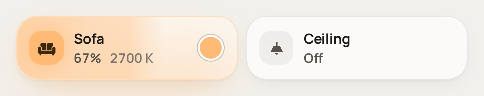<br>
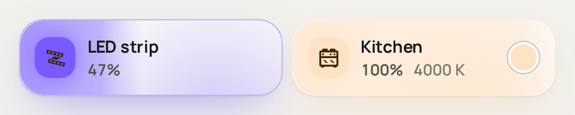<br>
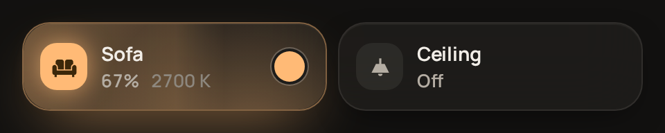

Duży kafel jednego światła, który świeci kolorem żarówki.

- **Dotknięcie** włącza i wyłącza.
- **Przesunięcie palcem** w lewo lub w prawo ustawia jasność.
- **Kółko** po prawej zmienia biel na cieplejszą lub chłodniejszą.
- **Dotknięcie ikony albo przytrzymanie** otwiera pełne sterowanie: jasność, cztery odcienie bieli rozłożone na zakresie Twojej żarówki, a w kolorowych żarówkach osiem kolorów i koło barw.

Grupa świateł pokazuje, ile z nich świeci („2 z 3 włączone”). W małym miejscu (poniżej 220 px) kafel robi się niższy, a nazwa może zająć dwie linie.

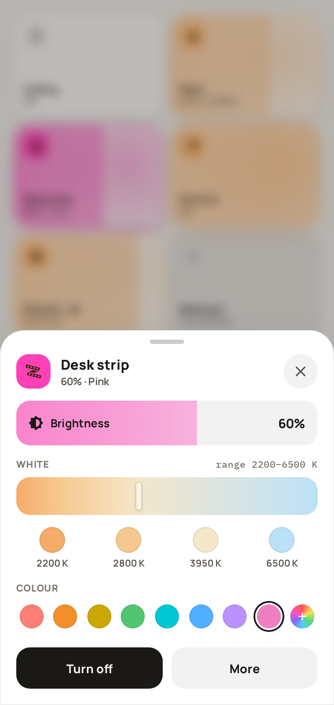

**Kilka żarówek za osobnymi włącznikami** (np. dwa kinkiety, każdy na swoim kanale włącznika). Wybierz grupę żarówek jako światło, a włączniki w polu **Zasilanie (kilka przekaźników)**. Powstaje jedna karta:

- **Małe przyciski na karcie**, po jednym na włącznik, włączają i wyłączają każdy z nich osobno. Tylko one sterują prądem.
- **Dotknięcie karty** nic nie robi.
- **Gdy świeci choć jeden kinkiet**, przesunięcie palcem ustawia jasność, a kółko i ikona barwę całej grupy. Karta pisze wtedy np. „1 z 2 włączone”.
- **Gdy oba są wyłączone**, karta jest wyłączona, a jasności i barwy nie da się zmienić. Żarówka bez prądu nie odbierze polecenia.

Żarówka, która w chwili zmiany była bez prądu, po włączeniu może mieć poprzednią jasność i barwę.

```yaml
type: custom:lumen-light-card
entity: light.kinkiety
name: Kinkiety
icon: mdi:wall-sconce-flat
power_entities:
  - light.kinkiet_1_wlacznik
  - light.kinkiet_2_wlacznik
sub_buttons:
  - entity: light.kinkiet_1_wlacznik
    name: Kinkiet 1
    icon: mdi:wall-sconce-flat
  - entity: light.kinkiet_2_wlacznik
    name: Kinkiet 2
    icon: mdi:wall-sconce-flat
```

Bez `sub_buttons` każdy przycisk bierze ikonę swojego włącznika albo żarówkę.

### Chipy

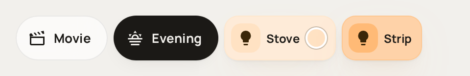

Rząd małych okrągłych przycisków. Są dwa rodzaje:

- **Akcja:** jednym dotknięciem uruchamia scenę, skrypt albo przycisk, np. „Film” czy „Wieczór”.
- **Światło:** mała pigułka światła, działa tak samo jak karta światła.

Na telefonie akcje mogą zamienić się w **pływający przycisk** w rogu ekranu. Dotknięcie pokazuje listę scen:

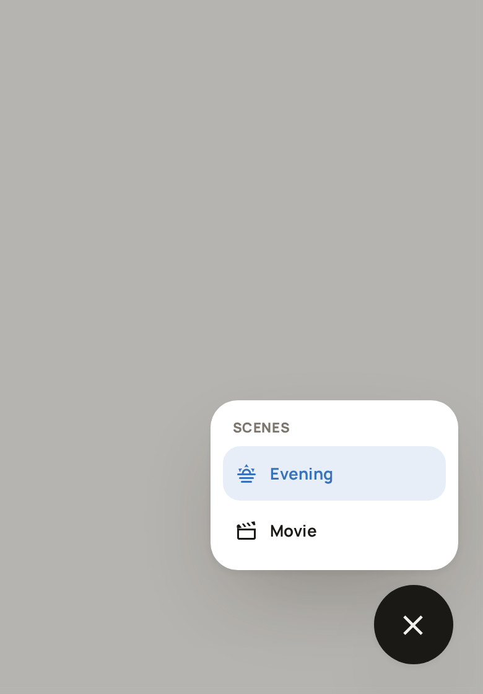

### Osoba

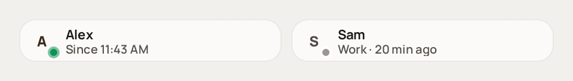

Domownik: zdjęcie (albo pierwsza litera imienia na kolorze dobranym do imienia), **zielona kropka, gdy jest w domu**, i od kiedy jest w domu albo poza nim. Gdy jest poza domem, karta pokazuje też gdzie, np. „Praca”. Jeśli obecność bierze się z czujnika, np. breloka Bluetooth, mówi o tym mały znacznik „BLE”.

### Alarm

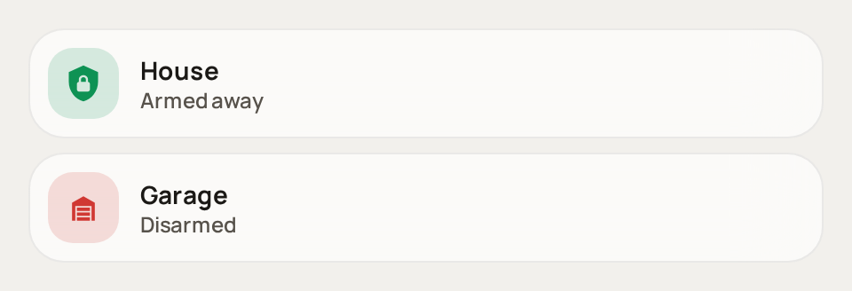

Stan alarmu w jednym spojrzeniu. Każdy tryb uzbrojenia jest zielony (ikona i podpis mówią: w domu, poza domem, noc, urlop), uzbrajanie ma żółty pasek odliczania z przyciskiem **Anuluj**, czas na wejście jest pomarańczowy i pulsuje, a wzbudzony alarm barwi kartę na czerwono.

**Uzbrój** otwiera klawiaturę z trybami, które obsługuje Twój alarm, **Rozbrój** samą klawiaturę. Przy błędnym kodzie kropki się trzęsą. Alarmy bez kodu przełączają się od razu.

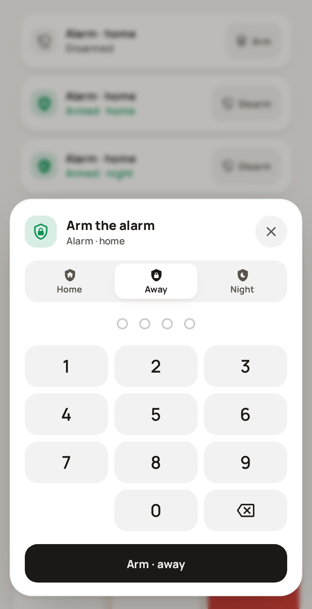

Kiedy alarm się włączy, cały ekran dodatkowo pulsuje na czerwono:

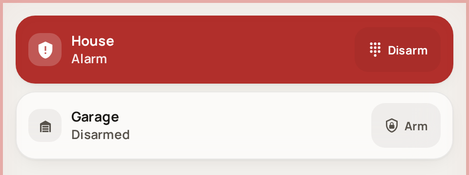

Wolisz własny skrypt? Ustaw go w `tap_action`, a karta i jej przyciski uruchomią skrypt zamiast klawiatury.

### Zamek

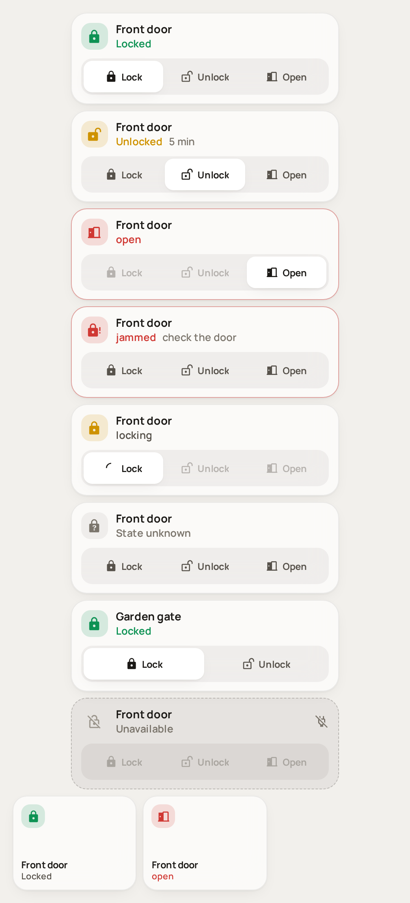

Czy zamek jest zamknięty, z przyciskami **Zablokuj** i **Odblokuj** (oraz **Otwórz**, jeśli zamek umie otworzyć drzwi). Pokazuje też, kiedy zamek pracuje, jest otwarty albo zablokowany mechanicznie (czerwona ramka). **Zablokuj** działa od razu; jeśli zamek wymaga PIN-u, **Odblokuj** i **Otwórz** najpierw o niego poproszą:

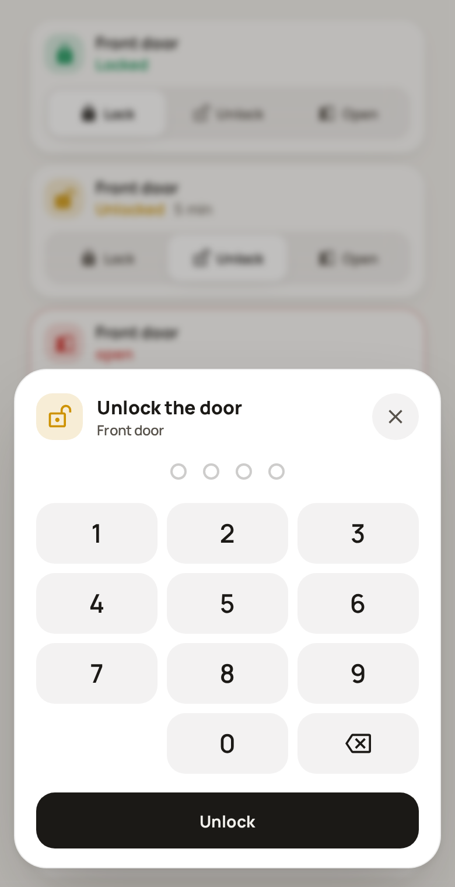

### Encja (drzwi, okno…)

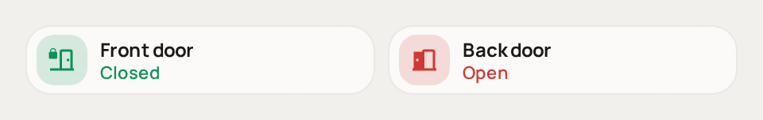

Mały kafel dla czegokolwiek, co ma stan. Drzwi i okna robią się **czerwone, gdy są otwarte**, a włączone urządzenia dostają kolor akcentu. Po prawej mieszczą się do czterech małych dodatkowych przycisków (dwa na wąskiej karcie). W małym miejscu karta zamienia się w mały kwadratowy przycisk z ikoną, jak w pasku dostępu.

### Przycisk

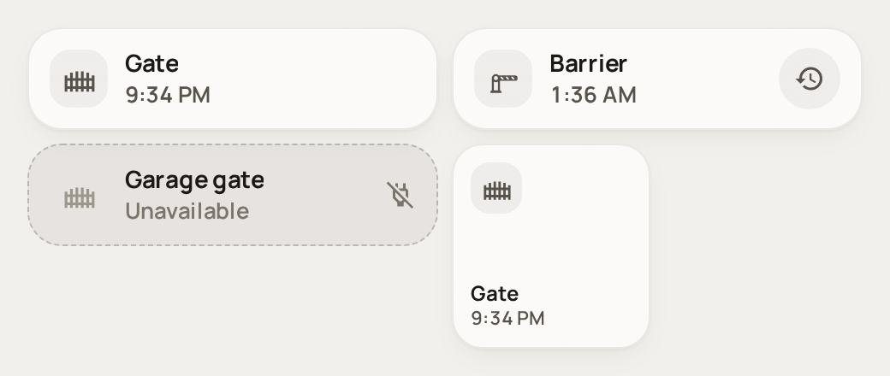

Jednym dotknięciem coś uruchamia: skrypt, scenę albo przycisk. Potrafi też **poczekać na odpowiedź** urządzenia (do 10 sekund), np. bramy, która zgłasza, czy naprawdę się otworzyła. Sukces świeci na zielono przez 6 sekund, a błąd dostaje czerwoną ramkę i zostaje do następnej próby.

Mały okrągły przycisk po prawej to **dodatkowy przycisk** (`sub_buttons`). Możesz dodać takie do kilku kart, np. żeby zapalić światło obok.

### Sensor

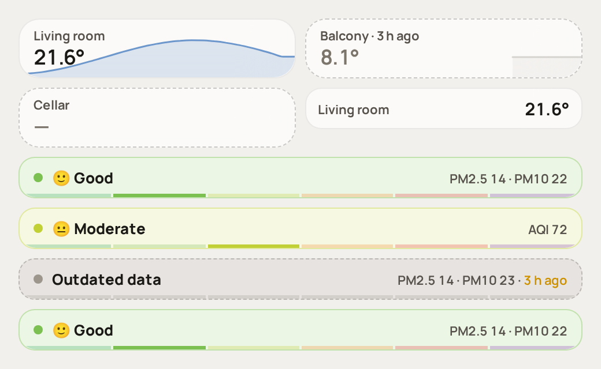

Temperatura (albo dowolna inna liczba) z małym wykresem z ostatnich godzin w tle. Dotknięcie pokazuje pełną historię. Gdy czujnik dawno nic nie wysłał, karta dostaje przerywaną ramkę i mówi, jak stara jest wartość.

### Klimatyzacja

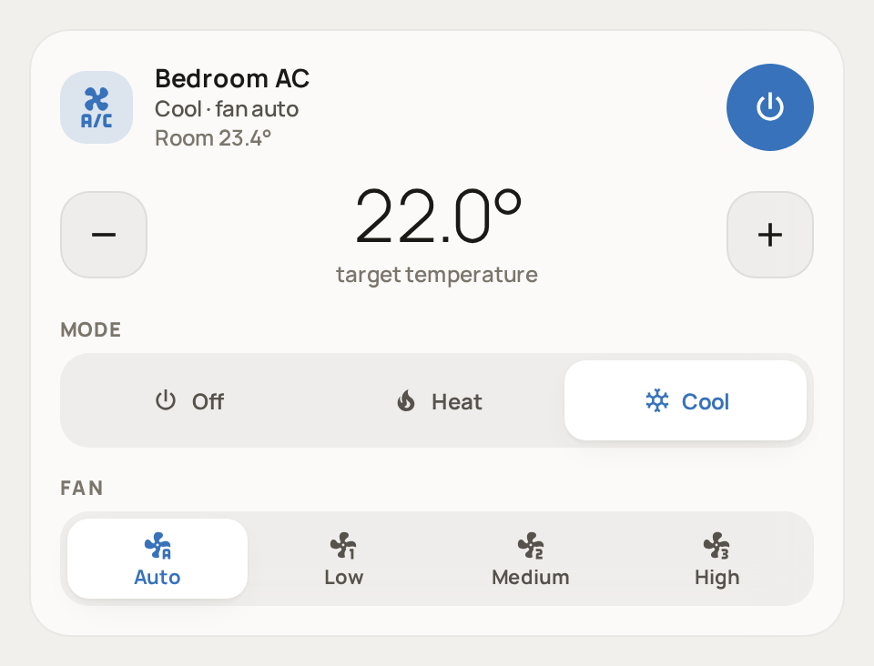

Klimatyzator albo termostat: temperatura docelowa z przyciskami **−** i **+**, tryby i prędkości nadmuchu, które ma Twoje urządzenie, kierunek nawiewu, presety i znacznik, co urządzenie robi teraz (grzeje, chłodzi, czeka). Termostaty z zakresem pokazują dwa pola: „Grzej do” i „Chłodź od”.

Na telefonie karta może zmienić się w **pływający okrągły przycisk** z temperaturą. Dotknięcie otwiera sterowanie, a przytrzymanie włącza lub wyłącza urządzenie:

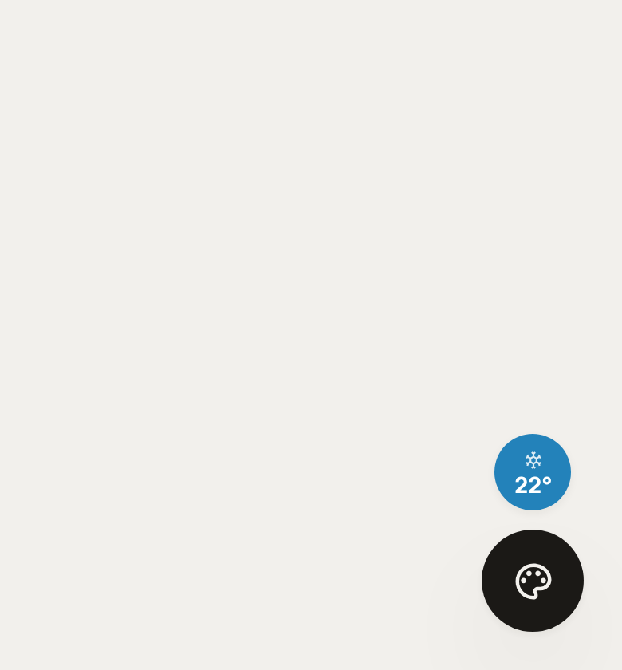
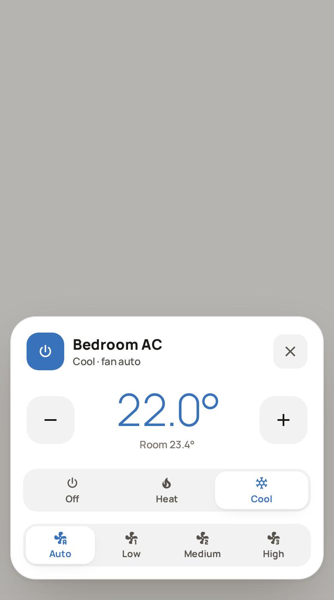

### Jakość powietrza

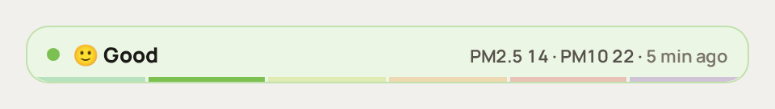

Zamienia PM2.5 / PM10 (albo czujnik AQI) na sześć prostych poziomów, od „Bardzo dobra” do „Bardzo zła”, według Europejskiego Indeksu Jakości Powietrza. Dotknięcie pokazuje wykres z 24 godzin. Gdy czujnik przestanie wysyłać dane, karta dostaje przerywaną ramkę i napis „Nieaktualne dane”.

### Przypomnienie

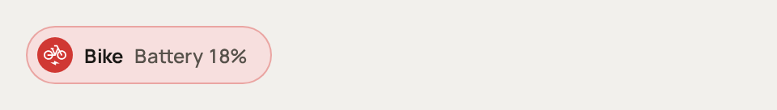

Mała pigułka, która pojawia się **tylko wtedy, gdy coś wymaga uwagi**, np. „Rower – bateria 18%”. Może też wyskoczyć okienko w chwili startu i potem przy każdym otwarciu dashboardu, aż dotkniesz **Gotowe**:

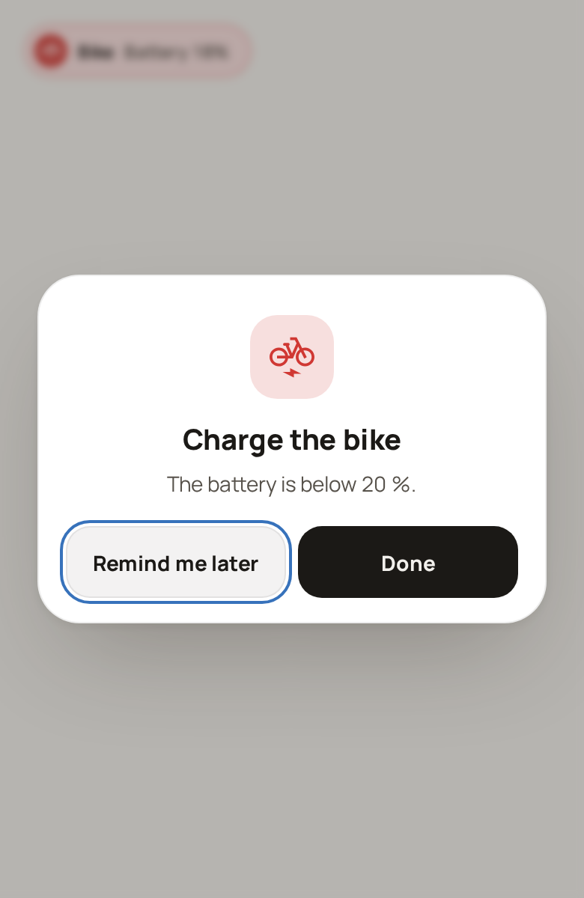

### Tytuł

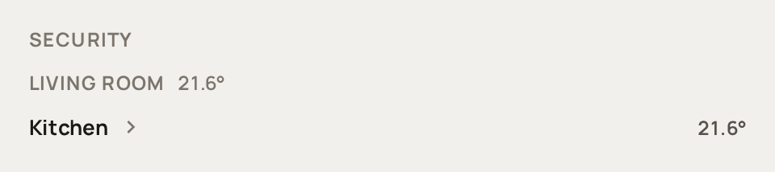

Nagłówki dzielące dashboard na części, w trzech stylach: mały napis wersalikami, duży tytuł sekcji albo nagłówek pokoju. Obok nagłówka mogą być wartości, np. temperatura w pokoju.

### Powitanie

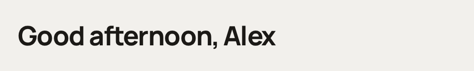

„Dzień dobry” albo „Dobry wieczór” z imieniem zalogowanej osoby i dzisiejszą datą.

### Tło pogodowe

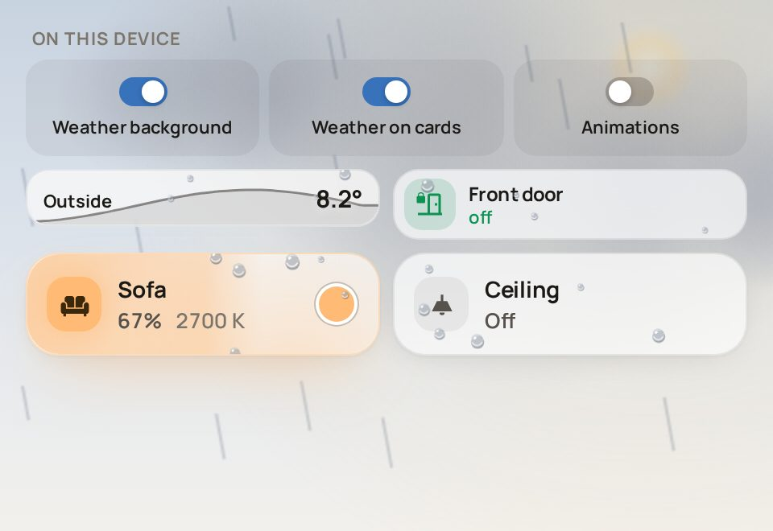
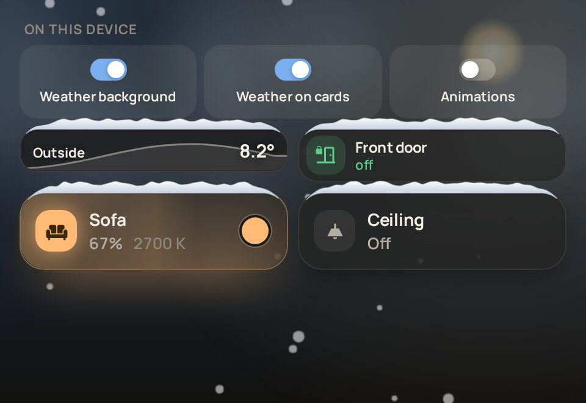

Dodaj tę kartę **raz na każdy widok dashboardu**, a niebo za kartami będzie pokazywać prawdziwą pogodę: słońce, chmury, deszcz, śnieg, mgłę, wiatr i burzę, w dzień i w nocy. Krople i śnieg pojawiają się też na innych kartach Lumen.

Sama karta nie zajmuje miejsca. Jeśli chcesz, może pokazać trzy przełączniki, żeby każde urządzenie decydowało za siebie: tło, pogoda na kartach i animacje. Przydaje się na starym tablecie.

### Rolety i bramy garażowe

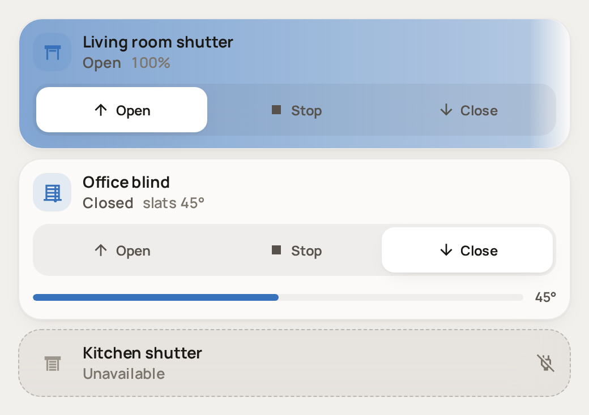

Rolety, żaluzje, bramy garażowe. **Przesuń palcem** po karcie, żeby ustawić pozycję (roleta rusza, gdy puścisz), albo użyj przycisków **Otwórz**, **Stop** i **Zamknij**. Żaluzje z ruchomymi lamelami mają drugi pasek dla lameli.

### Odtwarzacz

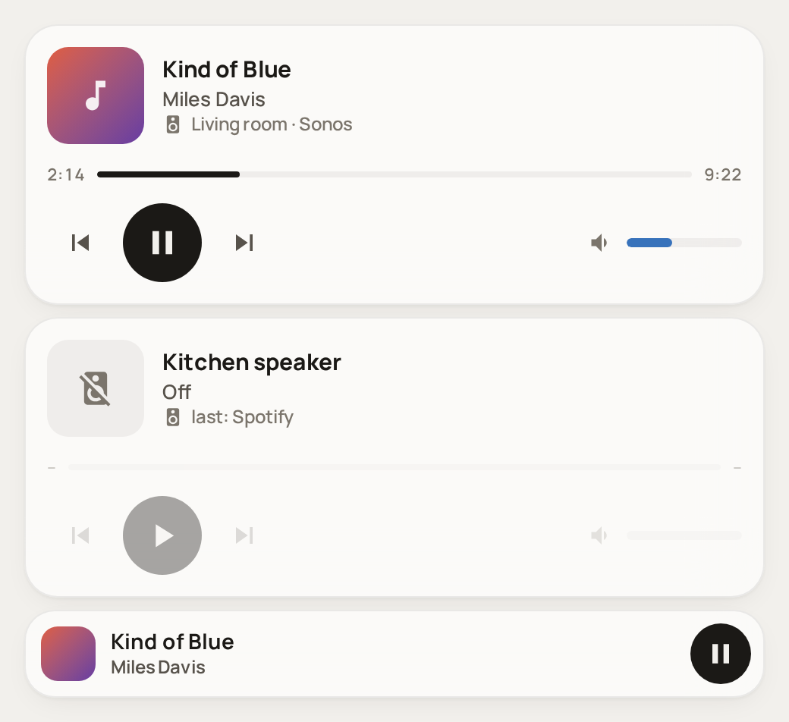

Głośniki i telewizory: okładka, tytuł i wykonawca, poprzedni / odtwarzaj-pauza / następny, postęp i głośność. W małym miejscu zamienia się w jeden wiersz z przyciskiem odtwarzania. Z `volume_only: true` staje się niskim kaflem z suwakiem głośności, przyciskami odtwarzania i wyciszeniem, np. dla soundbara.

### Lista wyboru

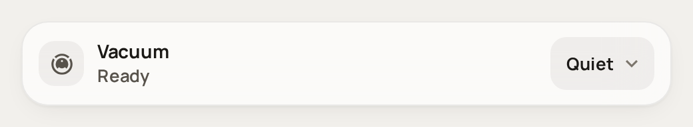

Dla pomocników `input_select` i `select`, np. tryb odkurzacza albo „w domu / poza domem / noc”. Dotknij, żeby rozwinąć listę i wybrać opcję.

### Wentylator i liczba

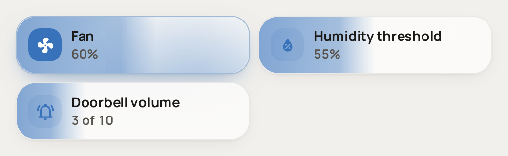

Wentylator, `input_number` albo `number` jako duży kafel z suwakiem: **przesuń palcem**, żeby ustawić prędkość albo wartość, **dotknij**, żeby włączyć lub wyłączyć wentylator. Ikona wentylatora kręci się tym szybciej, im wyższa prędkość.

### Kalendarz

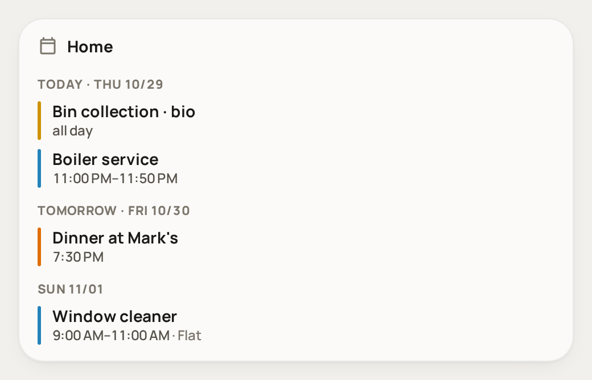

Najbliższe wydarzenia z kalendarza na kolejne dni, z wyraźnie oznaczonym dziś i jutro.

### Pasek nawigacji

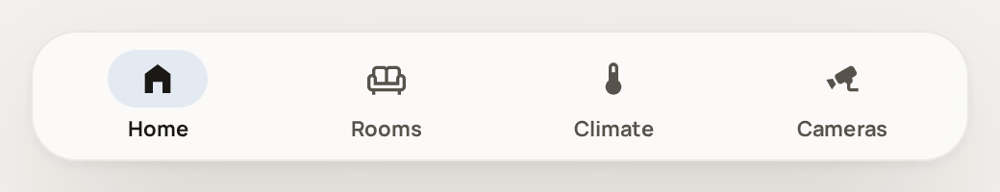

Pasek z przyciskami do widoków dashboardu (albo pop-upów). Może przykleić się do dołu ekranu jak pasek kart w aplikacji; pływające przyciski przesuwają się wtedy nad niego.

### Pop-up

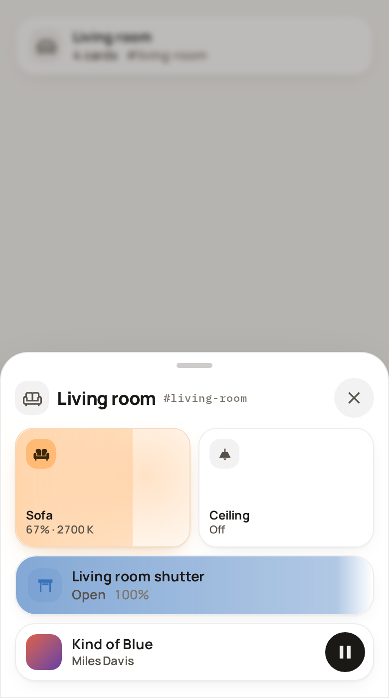

Okno z dowolnymi kartami, Lumen albo innymi, otwierane linkiem w stylu `#salon` (np. z paska nawigacji albo przycisku). Zamykasz je ×, klawiszem Esc, dotknięciem obok albo przesunięciem w dół. Sama karta jest na dashboardzie niewidoczna, chyba że chcesz wiersz, który ją otwiera.

### Stosy

Stos pionowy i poziomy jak wbudowane w Home Assistant (karty jedna pod drugą albo obok siebie po równo), z tym samym edytorem kart, ale z jedną maksymalną szerokością dla całej grupy – w procentach miejsca albo w pikselach, wyśrodkowaną albo przy brzegu. Karty w środku mogą mieć własne warunki widoczności, tak jak we wbudowanych stosach.

### Oczyszczacz powietrza

Oczyszczacz (także z nawilżaniem) na dowolnej encji `fan`. Sama encja wystarczy: karta pokazuje zasilanie oraz tryby i prędkości, które urządzenie ma. PM2.5, temperaturę, wilgotność, wodę i filtry znajduje sama na tym samym urządzeniu albo w atrybutach. Zmiany widać od razu, a jeśli urządzenie ich nie potwierdzi, karta je cofa i proponuje **Ponów**. Dotknięcie bloku PM2.5 albo przytrzymanie nagłówka otwiera wykresy i dodatkowe sterowanie.

### Odstęp

Niewidoczna karta z pustym miejscem. Dodaj ją na końcu dashboardu, a pływające przyciski nie zasłonią ostatniej karty: odstęp sam dopasowuje się do ich wysokości na ekranie, a gdy ich nie ma, np. na komputerze, nie zajmuje miejsca. Możesz też ustawić stałą wysokość. Podczas edycji dashboardu widać jej obrys.

### Pływający panel

Jeden pływający okrągły przycisk, który otwiera arkusz z dowolnymi kartami – najczęściej wszystkimi termostatami w jednym miejscu zamiast osobnego przycisku dla każdego. Przycisk pokazuje, ile z nich grzeje, przy grzaniu robi się pomarańczowy i delikatnie pulsuje, a o słabej baterii głowicy albo niedostępnym urządzeniu ostrzega znaczkiem w rogu. W arkuszu każdy termostat to jeden wiersz (−/+ zmienia temperaturę), a gdy termostaty mają te same presety, na górze jest **Wszystkie: Komfort / Eco / Wył.** dla wszystkich naraz. Na komputerze karta jest wierszem w siatce, który otwiera ten sam arkusz.

---

## Przykładowe dashboardy

To te dwa dashboardy z góry strony. Żeby użyć jednego z nich:

1. Utwórz nowy dashboard: **Ustawienia → Dashboardy → + Dodaj dashboard → Nowy dashboard od zera**.
2. Otwórz go, kliknij **ołówek**, potem **⋮ → Edytor konfiguracji w trybie surowym**.
3. Usuń wszystko, wklej przykład i kliknij **Zapisz**.
4. **Zamień przykładowe urządzenia na swoje.** Na przykład `light.sofa` zmień na nazwę swojego światła. Możesz to też zrobić później, karta po karcie, ołówkiem.

<details>
<summary><b>Dashboard na telefon</b> (jedna kolumna)</summary>

```yaml
views:
  - title: Home
    type: sections
    max_columns: 1
    sections:
      - type: grid
        cards:
          - type: custom:lumen-weather-background-card
            weather_entity: weather.home
          - type: custom:lumen-greeting-card
          # cztery małe kwadratowe przyciski w jednym rzędzie
          - type: custom:lumen-alarm-card
            entity: alarm_control_panel.house
            grid_options: { columns: 3 }
          - type: custom:lumen-alarm-card
            entity: alarm_control_panel.garage
            icon: mdi:garage
            grid_options: { columns: 3 }
          - type: custom:lumen-entity-card
            entity: binary_sensor.front_door
            grid_options: { columns: 3 }
          - type: custom:lumen-lock-card
            entity: lock.car
            icon: mdi:car
            grid_options: { columns: 3 }
          - type: custom:lumen-person-card
            entity: person.alex
            grid_options: { columns: 6 }
          - type: custom:lumen-person-card
            entity: person.sam
            grid_options: { columns: 6 }
          - type: custom:lumen-reminder-card
            entity: input_boolean.bike_battery
            name: Bike
            icon: mdi:bicycle-electric
            color: danger
            value: "Battery {value}%"
            value_entity: sensor.bike_battery
            title: Charge the bike
            message: The battery is below 20 %.
            done: true
            alignment: center
          - type: custom:lumen-title-card
            title: Living room
            heading_style: section
            badges: [sensor.living_temp]
          - type: custom:lumen-light-card
            entity: light.sofa
            icon: mdi:sofa
            grid_options: { columns: 6 }
          - type: custom:lumen-light-card
            entity: light.ceiling
            icon: mdi:ceiling-light
            grid_options: { columns: 6 }
          - type: custom:lumen-light-card
            entity: light.kitchen
            icon: mdi:stove
            grid_options: { columns: 6 }
          - type: custom:lumen-light-card
            entity: light.strip
            icon: mdi:led-strip-variant
            grid_options: { columns: 6 }
          - type: custom:lumen-air-quality-card
            pm25: sensor.pm25
            pm10: sensor.pm10
          - type: custom:lumen-sensor-card
            entity: sensor.living_temp
            grid_options: { columns: 6 }
          - type: custom:lumen-sensor-card
            entity: sensor.outside_temp
            color: light-blue
            grid_options: { columns: 6 }
          # te dwie karty stają się pływającymi przyciskami w rogu
          - type: custom:lumen-chips-card
            fab: true
            chips:
              - { type: action, entity: scene.movie }
              - { type: action, entity: scene.evening }
          - type: custom:lumen-climate-card
            entity: climate.bedroom_ac
            fab: true
```
</details>

<details>
<summary><b>Dashboard na tablet / komputer</b> (trzy kolumny)</summary>

```yaml
views:
  - title: Home
    type: sections
    max_columns: 3
    sections:
      - type: grid
        cards:
          - type: custom:lumen-weather-background-card
            weather_entity: weather.home
          - type: custom:lumen-greeting-card
          - type: custom:lumen-title-card
            title: Security
          - type: custom:lumen-alarm-card
            entity: alarm_control_panel.house
          - type: custom:lumen-alarm-card
            entity: alarm_control_panel.garage
            icon: mdi:garage
          - type: custom:lumen-title-card
            title: People
          - type: custom:lumen-person-card
            entity: person.alex
          - type: custom:lumen-person-card
            entity: person.sam
      - type: grid
        cards:
          - type: custom:lumen-chips-card
            chips:
              - { type: action, entity: scene.movie }
              - { type: action, entity: scene.evening }
          - type: custom:lumen-reminder-card
            entity: input_boolean.bike_battery
            name: Bike
            icon: mdi:bicycle-electric
            color: danger
            value: "Battery {value}%"
            value_entity: sensor.bike_battery
            done: true
            alignment: center
          - type: custom:lumen-title-card
            title: Living room
            heading_style: section
            badges: [sensor.living_temp]
          - type: custom:lumen-light-card
            entity: light.sofa
            icon: mdi:sofa
            grid_options: { columns: 6 }
          - type: custom:lumen-light-card
            entity: light.ceiling
            icon: mdi:ceiling-light
            grid_options: { columns: 6 }
          - type: custom:lumen-light-card
            entity: light.kitchen
            icon: mdi:stove
            grid_options: { columns: 6 }
          - type: custom:lumen-light-card
            entity: light.strip
            icon: mdi:led-strip-variant
            grid_options: { columns: 6 }
          - type: custom:lumen-title-card
            title: Kitchen
            heading_style: room
            badges: [sensor.living_temp]
          - type: custom:lumen-chips-card
            chips:
              - { type: light, entity: light.kitchen, name: Stove }
              - { type: light, entity: light.strip, name: Strip }
      - type: grid
        cards:
          - type: custom:lumen-title-card
            title: Access
          - type: custom:lumen-entity-card
            entity: binary_sensor.front_door
            grid_options: { columns: 6 }
          - type: custom:lumen-entity-card
            entity: binary_sensor.back_door
            grid_options: { columns: 6 }
          - type: custom:lumen-lock-card
            entity: lock.car
            icon: mdi:car
          - type: custom:lumen-button-card
            entity: script.gate
            icon: mdi:gate
            grid_options: { columns: 6 }
          - type: custom:lumen-title-card
            title: Climate
          - type: custom:lumen-air-quality-card
            pm25: sensor.pm25
            pm10: sensor.pm10
          - type: custom:lumen-sensor-card
            entity: sensor.living_temp
            grid_options: { columns: 6 }
          - type: custom:lumen-sensor-card
            entity: sensor.outside_temp
            color: light-blue
            grid_options: { columns: 6 }
          - type: custom:lumen-climate-card
            entity: climate.bedroom_ac
```
</details>

> **Jeden dashboard na telefon i tablet?** Tak. Dodaj kartę dwa razy: raz małą (np. na 3 kolumny), widoczną tylko na telefonie, i raz dużą, widoczną tylko na dużym ekranie. W edytorze karty otwórz zakładkę **Widoczność** → **Dodaj warunek** → **Ekran** i zaznacz rozmiary ekranu. Home Assistant sam ukryje drugą kopię.

---

## Ustawienia kart

Wszystko to zmienisz w edytorze karty. Nazwy zapisane `takim krojem` to nazwy w YAML, gdybyś tam zajrzał.

### Ustawienia każdej karty

Znajdziesz je w sekcjach **Wygląd** i **Zaawansowane** na dole edytora.

| Ustawienie | Co robi | Domyślnie |
|---|---|---|
| `layout` | **Auto** sam wybiera wygląd: kompaktowy, gdy karta jest mała. **Pełny** albo **Kompaktowy** wymusza jeden wygląd. | Auto |
| `color_scheme` | Karta jasna albo ciemna, albo **Auto**, czyli jak w Home Assistant | Auto |
| `accent_color` | Kolor przycisków i wyróżnień (włączone urządzenia, dodatkowe przyciski, suwaki, pływający przycisk, pigułka przypomnienia – ma pierwszeństwo przed jej polem `color`). Nie ma go w kartach bez niczego do pokolorowania (powitanie, tytuł, jakość powietrza, kalendarz, pop-up). | z motywu |
| `glow_color` | Kolor poświaty włączonych świateł (karty światła i chipów) | kolor światła |
| `weather_effects` | Krople, śnieg itp. na tej karcie. Wymaga karty tła pogodowego w tym samym widoku. | wł. |
| `max_width` | Karta nie będzie szersza niż ta wartość i zostanie wyśrodkowana w swoim miejscu: piksele albo procent miejsca w siatce z `max_width_unit: "%"` (lub `max_width: 80%`). Przydaje się w widoku „Panel” i w bardzo szerokich sekcjach; w zwykłym widoku sekcji kolumny i tak trzymają karty wąsko. | cała szerokość |
| `max_width_unit` | `px` albo `%` dla liczbowego `max_width` | `px` |
| `tap_action`, `hold_action`, `double_tap_action` | Co dzieje się po dotknięciu, przytrzymaniu albo dwukrotnym dotknięciu: przełączenie, szczegóły, inna strona, skrypt… | zależy od karty |
| `sub_buttons` | Małe dodatkowe okrągłe przyciski po prawej stronie karty, każdy z własnym urządzeniem i akcją. Są w kartach światła, encji, przycisku, osoby i alarmu. Widać najwyżej 4 (2 na wąskiej karcie, 1 na kompaktowej); o nadmiarze ostrzega edytor. | brak |
| — | **Podgląd układu w edycji:** przełącznik na dole widoku (Wszystko / Telefon / Komputer) ukrywa karty i sekcje drugiego rozmiaru ekranu, więc każdy układ edytujesz osobno. Sprawdza warunki ekranu HA (min. / maks. szerokość), zapamiętuje wybór na urządzeniu i znika po wyjściu z edycji. Pojawia się, gdy w widoku jest choć jedna karta Lumen. | – |
| `edit_note` | Opis widoczny na karcie tylko podczas edycji dashboardu. Karty z warunkiem ekranu (swoim albo sekcji) dostają tam też automatycznie etykietę „Telefon” / „Komputer” (z dopiskiem „sekcja”, gdy warunek jest na sekcji, a nie na karcie): HA w trybie edycji pokazuje wszystkie, nie odróżniając ich. | brak |
| `styles` | Dla majsterkowiczów: własny CSS wewnątrz karty | brak |
| `haptics` | Delikatne wibracje przy dotknięciu, przytrzymaniu i przeciąganiu (najlżejsze tyknięcie co 1 %, nieco mocniejsze na końcach skali). Działa w aplikacji HA i w przeglądarce na Androidzie. | wł. |

**Kolory.** `accent_color` i `glow_color` przyjmują nazwy kolorów z Home Assistanta (`blue`, `pink`…), hex albo rgb. Z tego jednego koloru karta buduje cały komplet: wypełnienie, poświatę, tło ikony i czytelny kolor tekstu, w trybie jasnym i ciemnym.

**Kiedy coś jest nie tak.** Karta, której urządzenia nie ma albo której ustawienia są niepełne, pokazuje czytelną kartę błędu Lumen z powodem, zamiast się psuć. Póki Home Assistant się ładuje, karty pokazują delikatny zarys, a w wyszukiwarce kart przykładowe dane.

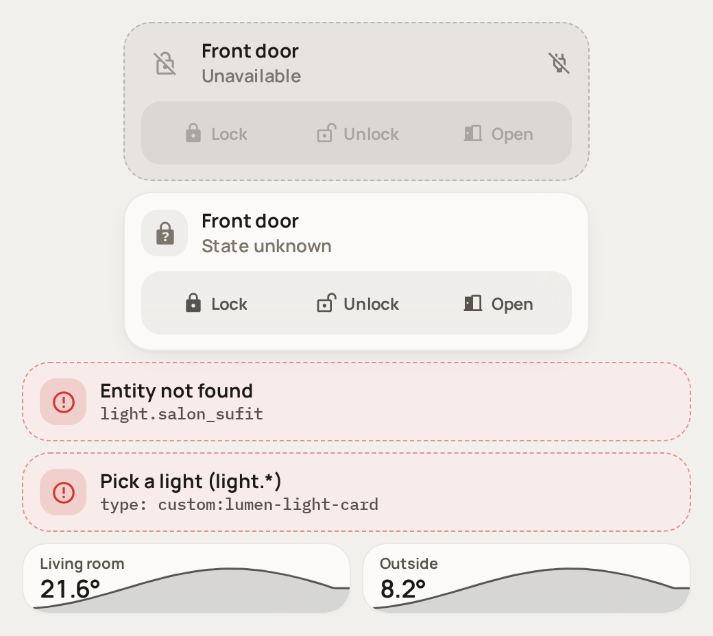

<a id="lumen-light-card"></a>

### Światło (`lumen-light-card`)

| Ustawienie | Co robi | Domyślnie |
|---|---|---|
| `entity` | Światło | – |
| `name`, `icon` | Nazwa i ikona na kaflu | z urządzenia |
| `power_entity` | Włącznik albo przekaźnik, który zasila żarówkę. Gdy jest wyłączony, żarówka jest „wyłączona”, a nie „niedostępna”, a dotknięcie przełącza przekaźnik. | brak |
| `power_entities` | Kilka włączników zasilających to światło, zwykle grupę żarówek (zobacz niżej). Zastępuje `power_entity`. | brak |
| `sub_buttons` | Małe dodatkowe przyciski na kaflu. Przy `power_entities` domyślnie po jednym na włącznik. | brak |
| `show_state` | Pokazuj linię z jasnością | wł. |
| `show_color_button` | Pokazuj kółko barwy | wł. |

<a id="lumen-chips-card"></a>

### Chipy (`lumen-chips-card`)

| Ustawienie | Co robi | Domyślnie |
|---|---|---|
| `chips` | Lista chipów. Każdy ma `type`: **action** (scena, skrypt, przycisk…) albo **light** (światło). Każdy ma też `entity`, a opcjonalnie `name`, `icon` i `tap_action`. Chip światła może mieć `power_entity`. | – |
| `active_value`, `active_attribute` (w chipie) | Chip akcji jest podświetlony, gdy stan encji albo ten atrybut ma tę wartość, np. tryb dźwięku | – |
| `alignment` | Do lewej, do środka, do prawej albo rozłożone | do lewej |
| `fab` | **Pokaż jako pływający przycisk**: akcje przechodzą do okrągłego przycisku w prawym dolnym rogu | wył. |
| `fab_narrow_only` | **Auto: tylko na wąskim ekranie.** Pływający przycisk pojawia się tylko na telefonie i tablecie w pionie, a na szerszych ekranach zostaje zwykły rząd chipów. Odznacz, żeby przycisk pływał zawsze. | wł. |
| `fab_side` | **Strona przycisku**: prawa (domyślnie) albo lewa, np. dla osoby leworęcznej. Każda strona ma swój stos pływających przycisków. | prawa |
| `title` | Nagłówek nad pozycjami pływającego przycisku | „Sceny” |

<a id="lumen-person-card"></a>

### Osoba (`lumen-person-card`)

| Ustawienie | Co robi | Domyślnie |
|---|---|---|
| `entity` | Osoba | – |
| `presence_entity` | Czujnik, który najlepiej wie, czy ktoś jest w domu, np. brelok Bluetooth. Bez niego liczy się strefa „dom” osoby. | brak |
| `name` | Wyświetlane imię | z osoby |
| `picture` | Adres (URL) zdjęcia | zdjęcie osoby |
| `avatar_color` | Kolor tła za literą, gdy nie ma zdjęcia | dobrany do imienia |
| `presence_badge` | Krótki znacznik obok imienia, gdy obecność pochodzi z `presence_entity`; puste = bez znacznika | „BLE” |
| `show_name`, `show_status` | Pokazuj imię / linię „w domu od…” | wł. |

<a id="lumen-alarm-card"></a>

### Alarm (`lumen-alarm-card`)

| Ustawienie | Co robi | Domyślnie |
|---|---|---|
| `entity` | Centrala alarmu | – |
| `name`, `icon` | Nazwa oraz ikona zamiast tarczy (np. garaż) | z urządzenia |
| `banner` | Czerwony baner, gdy alarm się włączy | wł. |
| `banner_text` | Tekst banera | „Alarm: *nazwa*!” |
| `screen_ring` | Czerwona pulsująca ramka wokół całego ekranu, gdy alarm się włączy | wł. |
| `show_state` | Pokazuj linię stanu | wł. |
| `show_buttons` | Przycisk Uzbrój / Rozbrój na karcie | wł. |
| `arm_modes` | Które tryby oferuje klawiatura (`armed_home`, `armed_away`, `armed_night`, `armed_vacation`, `armed_custom_bypass`) | wszystkie, które ma alarm |
| `arming_time`, `pending_time` | Długość odliczania przy uzbrajaniu i czasu na wejście w sekundach, jeśli alarm ich nie podaje | z alarmu |

Wskazówka: ustaw `tap_action` na swój skrypt uzbrajania/rozbrajania, wtedy karta i jej przyciski uruchamiają skrypt zamiast klawiatury.

<a id="lumen-lock-card"></a>

### Zamek (`lumen-lock-card`)

| Ustawienie | Co robi | Domyślnie |
|---|---|---|
| `entity` | Zamek | – |
| `name`, `icon` | Nazwa i ikona | z urządzenia |
| `busy_entity` | Czujnik, który jest „włączony”, kiedy zamek pracuje (niektóre zamki w autach potrzebują chwili). Karta poczeka na koniec, zanim napisze „gotowe”. | brak |
| `show_state` | Pokazuj linię stanu | wł. |

<a id="lumen-entity-card"></a>

### Encja (`lumen-entity-card`)

| Ustawienie | Co robi | Domyślnie |
|---|---|---|
| `entity` | Dowolne urządzenie albo czujnik | – |
| `name`, `icon` | Nazwa i ikona | z urządzenia |
| `show_name`, `show_icon`, `show_state` | Pokazuj albo ukryj każdą część | wł. |

<a id="lumen-button-card"></a>

### Przycisk (`lumen-button-card`)

| Ustawienie | Co robi | Domyślnie |
|---|---|---|
| `entity` | Co przycisk uruchamia: skrypt, scenę, przycisk albo cokolwiek, co da się przełączyć | – |
| `name`, `icon` | Nazwa i ikona | z urządzenia |
| `feedback` | **Czekaj na odpowiedź urządzenia** po dotknięciu. Wypełnij `status_entity` (czujnik z kodem odpowiedzi), `success_state` (kod oznaczający sukces, domyślnie `"200"`), `message_entity` (czujnik z treścią błędu) i `success_text` (tekst po sukcesie). | wył. |
| `last_used_entity` | Pomocnik „data i godzina”, w którym zapisuje się ostatnie użycie | brak |
| `secondary_info` | Druga linia: **Auto** (ostatnie użycie), stan, ostatnie uruchomienie, ostatnia zmiana albo nic | Auto |
| `show_name`, `show_icon`, `show_state` | Pokazuj albo ukryj każdą część | wł. |

<a id="lumen-sensor-card"></a>

### Sensor (`lumen-sensor-card`)

| Ustawienie | Co robi | Domyślnie |
|---|---|---|
| `entity` | Czujnik | – |
| `name` | Wyświetlana nazwa | z czujnika |
| `hours` | Ile godzin obejmuje wykres | 12 |
| `color` | Kolor wykresu | kolor akcentu |
| `show_name`, `show_graph` | Pokazuj nazwę / wykres | wł. |
| `stale_after` | Po ilu godzinach bez nowego odczytu karta pokaże wartość jako nieaktualną | 2 |

<a id="lumen-climate-card"></a>

### Klimatyzacja (`lumen-climate-card`)

| Ustawienie | Co robi | Domyślnie |
|---|---|---|
| `entity` | Klimatyzator albo termostat | – |
| `name`, `icon` | Nazwa i ikona | z urządzenia |
| `hvac_modes` | Które przyciski trybu pokazać | wszystkie, które ma urządzenie |
| `fan_modes` | Które przyciski nadmuchu pokazać (więcej niż 5 zamienia się w listę) | wszystkie, które ma urządzenie |
| `preset_modes` | Które presety pokazać | wszystkie, które ma urządzenie |
| `min_temp`, `max_temp` | Zawęża zakres temperatur (puste = zakres urządzenia) | zakres urządzenia |
| `step` | O ile zmieniają nastawę − i + (np. `0.5`, gdy termostat podaje 0,1). Nastawa idzie do urządzenia 1 s po ostatnim dotknięciu. | krok z urządzenia |
| `fab` | **Pokaż jako pływający przycisk** w rogu | wył. |
| `fab_narrow_only` | **Auto: tylko na wąskim ekranie**: pływający przycisk na telefonie, zwykła karta na dużym ekranie | wł. |
| `fab_side` | **Strona przycisku**: prawa (domyślnie) albo lewa, np. dla osoby leworęcznej. Każda strona ma swój stos pływających przycisków. | prawa |
| `power_action` | Co robi przycisk zasilania, jeśli wolisz własny skrypt | włącza ostatni tryb / wyłącza |
| `show_current_temp`, `show_modes`, `show_fan_modes` | Pokazuj temperaturę w pokoju / przyciski trybu / przyciski nadmuchu | wł. |
| `battery_entity`, `battery_low`, `show_battery` | Znacznik słabej baterii („Bateria 9%”). Domyślnie czyta informację o bateriach z Better Thermostat na samym termostacie (najsłabsza głowica); można też podać czujnik w % albo czujnik binarny baterii. Słaba poniżej `battery_low` % (domyślnie 15). | wł. |
| `show_swing`, `show_presets`, `show_action` | Pokazuj kierunek nawiewu / presety / znacznik „grzeje, chłodzi, czeka” | wł. |
| `show_range` | Zakres temperatur urządzenia pod temperaturą docelową | wył. |

Karta pokazuje tylko tryby, które urządzenie naprawdę ma. Termostaty z zakresem „od–do” też działają: dotknij dolnej albo górnej liczby, żeby wybrać, którą zmieniają **−** i **+**.

<a id="lumen-air-quality-card"></a>

### Jakość powietrza (`lumen-air-quality-card`)

| Ustawienie | Co robi | Domyślnie |
|---|---|---|
| `pm25`, `pm10`, `aqi_entity` | Twoje czujniki powietrza. Wystarczy jeden z trzech. | – |
| `stale_hours` | Po ilu godzinach bez nowych danych karta pokaże „Nieaktualne dane” | 1 |
| `footer` | Krótka notka na dole okna z wykresem, np. „Czujnik na balkonie” | brak |
| `levels` | Własne nazwy sześciu poziomów (tylko w YAML) | Bardzo dobra … Bardzo zła |
| `show_values`, `show_bar` | Pokazuj liczby / kolorowy pasek poziomów | wł. |

<a id="lumen-reminder-card"></a>

### Przypomnienie (`lumen-reminder-card`)

| Ustawienie | Co robi | Domyślnie |
|---|---|---|
| `entity` | Co obserwować, np. pomocnik-przełącznik „niska bateria roweru” | – |
| `state` | Przypomnienie działa, dopóki urządzenie ma ten stan | `on` |
| `name`, `icon`, `color` | Napis, ikona i kolor pigułki (informacja, OK, ostrzeżenie, alarm) | z urządzenia, informacja |
| `value`, `value_entity` | Dodatkowy tekst na pigułce; `{value}` zamienia się w liczbę z `value_entity`, np. „Bateria {value}%” | brak |
| `show_chip` | Czy w ogóle pokazywać pigułkę (wył. = tylko okienko) | wł. |
| `dialog` | Okienko w chwili, gdy przypomnienie startuje | wł. |
| `title`, `message` | Nagłówek i tekst okienka | nazwa |
| `done` | Przycisk **Gotowe**, który wyłącza przypomnienie | wył. |
| `done_action` | Inna akcja dla **Gotowe** | wyłączenie encji |
| `alignment` | Gdzie stoi pigułka: z lewej, na środku, z prawej | z lewej |

<a id="lumen-title-card"></a>

### Tytuł (`lumen-title-card`)

| Ustawienie | Co robi | Domyślnie |
|---|---|---|
| `title` | Tekst | – |
| `heading_style` | **Nadtytuł** (małe wersaliki), **Tytuł sekcji** (duży) albo **Nagłówek pokoju** | Nadtytuł |
| `badges` | Wartości obok tytułu. Każda ma `entity`, a opcjonalnie `state_content` (atrybut zamiast stanu) i `name` (napis przed wartością). | brak |
| `entity`, `tap_action` | Co otwiera dotknięcie tytułu | nic |

<a id="lumen-greeting-card"></a>

### Powitanie (`lumen-greeting-card`)

| Ustawienie | Co robi | Domyślnie |
|---|---|---|
| `show_date` | Data nad powitaniem | wł. |
| `name` | Imię po powitaniu | zalogowana osoba |
| `sun_entity` | Czujnik słońca, po którym karta poznaje porę dnia | `sun.sun` |

<a id="lumen-weather-background-card"></a>

### Tło pogodowe (`lumen-weather-background-card`)

| Ustawienie | Co robi | Domyślnie |
|---|---|---|
| `weather_entity` | Twoje urządzenie z prognozą pogody | – |
| `sun_entity` | Czujnik słońca (dzień i noc) | `sun.sun` |
| `show_controls` | Pokazuj trzy przełączniki: tło pogodowe, pogoda na kartach, animacje. Każde urządzenie pamięta swój wybór. | wył. |

<a id="lumen-cover-card"></a>

### Rolety (`lumen-cover-card`)

| Ustawienie | Co robi | Domyślnie |
|---|---|---|
| `entity` | Roleta, żaluzja albo brama garażowa | – |
| `name`, `icon` | Nazwa i ikona | z urządzenia |
| `show_buttons` | Rząd Otwórz / Stop / Zamknij (Stop tylko, gdy roleta umie się zatrzymać) | wł. |
| `show_tilt` | Pasek lameli (tylko żaluzje z ruchomymi lamelami) | wł. |
| `show_state` | Pokazuj linię stanu | wł. |
| `tap_action`, `hold_action` | Dotknięcie i przytrzymanie | otwórz/zamknij, szczegóły |

<a id="lumen-media-card"></a>

### Odtwarzacz (`lumen-media-card`)

| Ustawienie | Co robi | Domyślnie |
|---|---|---|
| `entity` | Głośnik albo telewizor | – |
| `name`, `icon` | Nazwa oraz ikona, gdy nie ma okładki | z urządzenia |
| `show_progress` | Pasek postępu (dotknięcie przewija, jeśli odtwarzacz to umie) | wł. |
| `show_volume` | Suwak głośności i wyciszenie | wł. |
| `volume_only` | Niski kafel z suwakiem głośności: bez okładki i tytułu utworu. Po prawej przyciski odtwarzania i wyciszenie, tyle, ile się zmieści: wszystkie od 320 px, odtwarzanie i wyciszenie od 200 px, poniżej samo odtwarzanie. Głośność zmienia się w trakcie przeciągania. Odtwarzacz z samymi klawiszami głośności (Android TV Remote) dostaje poziom przez pojedyncze naciśnięcia, a kafel przeskakuje między tymi poziomami | wył. |
| `volume_remote` | Przy `volume_only` na odtwarzaczu z Android TV Remote: jego encja `remote.*`, dzięki czemu duży skok idzie jednym szybkim poleceniem, a nie klawisz po klawiszu. | – |
| `show_playback` | Przy `volume_only`: przyciski poprzedni, odtwarzanie/pauza i następny. Wyciszenie zostaje. | wł. |
| `volume_step` | Przy `volume_only` na odtwarzaczu z samymi klawiszami głośności: o ile zmienia jedno naciśnięcie, w procentach. | 4 |
| `show_source` | Nazwa odtwarzacza albo ostatnia aplikacja, gdy jest wyłączony | wł. |

<a id="lumen-select-card"></a>

### Lista wyboru (`lumen-select-card`)

| Ustawienie | Co robi | Domyślnie |
|---|---|---|
| `entity` | `input_select` albo `select` | – |
| `name`, `icon` | Nazwa i ikona | z urządzenia |
| `secondary_entity` | Inne urządzenie, którego stan widać w drugiej linii, np. status odkurzacza | brak |
| `tap_action`, `hold_action` | Dotknięcie i przytrzymanie | rozwiń listę, szczegóły |

<a id="lumen-fan-card"></a>

### Wentylator (`lumen-fan-card`)

| Ustawienie | Co robi | Domyślnie |
|---|---|---|
| `entity` | Wentylator | – |
| `name`, `icon` | Nazwa i ikona | z urządzenia |
| `icon_animation` | Kręcąca się ikona, szybsza przy wyższej prędkości | wł. |
| `show_state` | Pokazuj linię prędkości | wł. |
| `tap_action`, `hold_action` | Dotknięcie i przytrzymanie | wł./wył., szczegóły |

<a id="lumen-number-card"></a>

### Liczba (`lumen-number-card`)

| Ustawienie | Co robi | Domyślnie |
|---|---|---|
| `entity` | `input_number` albo `number` | – |
| `name`, `icon` | Nazwa i ikona | z urządzenia |
| `show_state` | Pokazuj linię z wartością | wł. |

<a id="lumen-calendar-card"></a>

### Kalendarz (`lumen-calendar-card`)

| Ustawienie | Co robi | Domyślnie |
|---|---|---|
| `entity` | Kalendarz | – |
| `name`, `icon` | Nazwa i ikona | z kalendarza |
| `days` | Na ile dni do przodu patrzeć | 7 |
| `max_events` | Najwyżej tyle wydarzeń | 5 |
| `show_title` | Nazwa kalendarza nad listą | wł. |

<a id="lumen-nav-card"></a>

### Pasek nawigacji (`lumen-nav-card`)

| Ustawienie | Co robi | Domyślnie |
|---|---|---|
| `items` | Przyciski. Każdy ma `navigation_path` (widok, np. `pokoje`, ścieżkę, np. `/lovelace/pokoje`, albo pop-up, np. `#salon`), `name` i `icon`. | – |
| `position` | **Na dole**: przyklejony do dołu ekranu (daj tę kartę na koniec). **W treści**: zwykła karta tam, gdzie ją wstawisz. | na dole |
| `narrow_only` | Pokazuj tylko na telefonach i wąskich ekranach | wył. |

<a id="lumen-popup-card"></a>

### Pop-up (`lumen-popup-card`)

| Ustawienie | Co robi | Domyślnie |
|---|---|---|
| `hash` | Link, który go otwiera, np. `#salon` | – |
| `name`, `icon` | Nagłówek okna | brak |
| `cards` | Karty w środku (dowolne karty Home Assistanta, edytowane w YAML) | – |
| `show_trigger` | Pokazuj na dashboardzie wiersz, który otwiera pop-up (inaczej karta jest niewidoczna) | wył. |
| `auto_close` | Zamknij samo po tylu sekundach (0 = nigdy) | 0 |

### Stosy (`lumen-vertical-stack-card`, `lumen-horizontal-stack-card`)

```yaml
type: custom:lumen-vertical-stack-card
max_width: 80
max_width_unit: "%"
cards:
  - type: custom:lumen-light-card
    entity: light.salon
  - type: custom:lumen-horizontal-stack-card
    cards:
      - type: tile
        entity: sun.sun
      - type: custom:lumen-weather-card
        entity: weather.dom
```

| Ustawienie | Co robi | Domyślnie |
|---|---|---|
| `cards` | Karty w środku (dowolne karty Home Assistanta, ten sam edytor co we wbudowanych stosach); pionowy – jedna pod drugą, poziomy – obok siebie po równo. Własne warunki widoczności kart działają. | – |
| `title` | Nagłówek nad kartami | brak |
| `max_width`, `max_width_unit` | Szerokość całego stosu: piksele albo procent miejsca karty w siatce (lub `max_width: 80%`) | cała szerokość |
| `align` | Położenie węższego stosu: `center` (na środku), `start` (do lewej), `end` (do prawej); przy `card_width: content` także położenie kart w wierszu | `center` |
| `card_width` | Tylko stos poziomy: `equal` – karty dzielą szerokość po równo, `content` – każda karta ma szerokość swojej treści i w razie potrzeby przechodzi do następnego wiersza (np. pigułki przypomnień) | `equal` |

<a id="lumen-purifier-card"></a>

### Oczyszczacz powietrza (`lumen-purifier-card`)

```yaml
type: custom:lumen-purifier-card
entity: fan.oczyszczacz
```

Wszystkie ustawienia są w edytorze wizualnym. Funkcje specyficzne dla modelu opisujesz konfiguracją:

```yaml
type: custom:lumen-purifier-card
entity: fan.oczyszczacz
preset_modes: [auto, sleep, night]
speeds:
  - { percentage: 20, name: Cichy }
  - { percentage: 100, name: Turbo }
humidity_targets: [40, 50, 60]
target_humidity_service: { service: moja_integracja.set_target_humidity, field: humidity }
humidifier_when: { attribute: function, contains: Humidification }
index: { name: Alergeny, attribute: allergen_index, thresholds: [3, 6, 9], labels: [Dobry, Średni, Słaby, Bardzo słaby], max: 12 }
filters:
  - { name: HEPA, entity: sensor.oczyszczacz_hepa, unit: h }
controls:
  - { entity: switch.oczyszczacz_blokada }
  - { name: Wyłącznik, attribute: timer, service: moja_integracja.set_timer, field: hours, min: 0, max: 12, min_label: Wył. }
  - { name: Jasność, attribute: brightness, service: moja_integracja.set_brightness, field: level, options: [0, 50, 100] }
```

| Ustawienie | Co robi | Domyślnie |
|---|---|---|
| `entity` | Encja `fan` | – |
| `layout` | `wide` albo `compact` (wiersz 58 px) | `wide` |
| `hours`, `stale_hours` | Okno wykresu w karcie; po ilu godzinach bez odczytu dane są nieaktualne (0 = nigdy) | 24, 2 |
| `preset_modes` | Które tryby pokazać i w jakiej kolejności | wszystkie z urządzenia |
| `speeds` | Własne prędkości: `percentage`, `name` | z `percentage_step`, numerowane |
| `humidifier_entity` | Standardowa encja `humidifier` (`set_humidity`) | brak |
| `humidity_targets`, `target_humidity_service` | Przyciski celu; usługa dla integracji bez encji nawilżacza | brak |
| `humidifier_when` | Pokazuj nawilżanie, gdy atrybut zawiera tekst | zawsze przy odczycie wilgotności |
| `show_humidifier`, `show_filters` | Pokazuj te części | wł. |
| `filters` | `name`, `entity` albo `attribute`, `unit` (`%`, `h`, `d`) | sensory z „filter” w nazwie, potem atrybuty |
| `index` | Drugi wskaźnik: `name`, `entity` albo `attribute`, `thresholds`, `labels`, `max` | brak |
| `controls` | Sterowanie w szczegółach: encja (`switch`, `light`, `select`, `number`…) albo `attribute` + `service` + `field`, z `options` (wybór) lub `min`/`max`/`step` (− / +) | brak |
| `confirm_timeout` | Sekundy na potwierdzenie zmiany | 45 |
| `send_delay` | Sekundy ciszy po ostatnim dotknięciu przed wysłaniem polecenia. Seria kliknięć to jedno polecenie, a między poleceniami jest co najmniej 1 s | 0,8 |
| `pm25_entity`, `temperature_entity`, `humidity_entity`, `target_humidity_entity`, `water_level_entity`, `water_empty_entity` | Nadpisania sensorów | szukane na urządzeniu |

Skala PM2.5 jest taka sama jak w karcie jakości powietrza. Poza HA, bez rejestru encji, działa szukanie po nazwie `sensor.<fan>_pm2_5` i atrybutach.

<a id="lumen-spacer-card"></a>

### Odstęp (`lumen-spacer-card`)

```yaml
type: custom:lumen-spacer-card
```

| Ustawienie | Co robi | Domyślnie |
|---|---|---|
| `height` | Stała wysokość w pikselach | na wysokość pływających przycisków na ekranie plus 16 px; bez przycisków 0 |

<a id="lumen-fab-sheet-card"></a>

### Pływający panel (`lumen-fab-sheet-card`)

```yaml
type: custom:lumen-fab-sheet-card
icon: mdi:radiator
title: Ogrzewanie
cards:
  - type: custom:lumen-climate-card
    entity: climate.salon
  - type: custom:lumen-climate-card
    entity: climate.sypialnia
```

| Ustawienie | Co robi | Domyślnie |
|---|---|---|
| `icon`, `title` | Ikona pływającego przycisku i nagłówek arkusza | `mdi:dock-bottom`, „Pływający panel” |
| `cards` | Karty w środku (dowolne karty Home Assistanta, edytowane w YAML). Karty klimatyzacji są tu kompaktowymi wierszami termostatów. | – |
| `narrow_only` | Pływający przycisk tylko na telefonie i wąskim ekranie (poniżej 1024 px); szerzej karta jest wierszem w siatce, który otwiera ten sam arkusz. Wył. = przycisk na każdym ekranie. | wł. |
| `fab_side` | **Strona przycisku**: prawa (domyślnie) albo lewa, np. dla osoby leworęcznej. Każda strona ma swój stos pływających przycisków. | prawa |
| `badge_entities` | Co liczy liczba na przycisku. Puste = termostaty z kart, które grzeją; inaczej te encje, gdy grzeją / są włączone. | puste |
| `color_scheme`, `accent_color`, `styles` | Jak w każdej karcie | – |

Przycisk dołącza do stosu pływających przycisków: nad przyciskiem scen (48 px) albo sam w rogu (64 px), gdy jest jedyny. Kolejność od dołu: sceny, panele (w kolejności z dashboardu), alarm. Znaczek ostrzeżenia to bateria poniżej `battery_low` karty termostatu (domyślnie 15%) albo niedostępna encja. W trybie edycji dashboardu karta zawsze jest wierszem z podpisem „FAB na telefonie”.

---

## Pytania i problemy

**Zainstalowałem, ale nie widzę kart.**
Odśwież przeglądarkę klawiszami Ctrl+F5 (na Macu Cmd+Shift+R). W aplikacji na telefonie: **Ustawienia → Aplikacja towarzysząca → Debugowanie → Zresetuj pamięć podręczną interfejsu**. Potem przy dodawaniu karty wpisz „Lumen”.

**Widzę „Custom element doesn't exist: lumen-…”.**
To samo: odśwież przeglądarkę. Jeśli dalej to widać, sprawdź **Ustawienia → Dashboardy → ⋮ → Zasoby**. Powinien tam być jeden wpis kończący się na `lumen-cards.js`.

**Na dashboardzie nie pada deszcz ani śnieg.**
Dodaj kartę **Tło pogodowe** do tego samego widoku (jedna na widok wystarczy) i wybierz w niej swoje urządzenie pogody. Na słabszych tabletach efekty mogą być wyłączone. Włącz `show_controls`, żeby zobaczyć przełączniki.

**Na telefonie karty wyglądają inaczej niż na tablecie.**
Tak ma być: mała karta pokazuje wersję kompaktową. Jeśli chcesz sam zdecydować, co gdzie widać, zajrzyj do wskazówki pod [Przykładowymi dashboardami](#przykładowe-dashboardy): dwie kopie karty i warunek widoczności **Ekran**. Możesz też ustawić `layout` na **Pełny** albo **Kompaktowy**, żeby wyłączyć automatyczne przełączanie.

**Pływający przycisk klimatyzacji coś zasłania.**
Kilka pływających przycisków samo ustawia się jeden nad drugim. Żeby podnieść je wyżej, np. nad dolny pasek nawigacji, dodaj do motywu Home Assistant `lumen-cards-fab-bottom: 90px`.

**Czy mogę zmienić kolory?**
Tak: `accent_color` i `glow_color` w każdej karcie albo dla wszystkich kart naraz zmiennymi `lumen-cards-accent` i `lumen-cards-glow-color` w motywie Home Assistant.

**Czy da się obsługiwać karty klawiaturą?**
Tak. Tab przechodzi między kartami, Enter albo spacja to dotknięcie, Shift+Enter to przytrzymanie (np. otwiera panel światła). Strzałki zmieniają jasność, a Escape zamyka okna.

---

## Dla programistów

Agenci AI: zobacz [AGENTS.md](AGENTS.md).

```sh
npm install
npm run dev     # demo na zmyślonych urządzeniach: http://localhost:5174/dev/index.html
npm test
npm run build   # → dist/
```

Opcje demo: `?compact`, `&dark`, `&lang=pl`, `&fx` (pogoda), `&weather=snowy`, `&scene=phone|desktop`, `&only=<karta>` (np. `fab-sheet`, `compact-row`), `&edit` (tryb edycji). Teksty są w `src/translations/en.json` i `pl.json`. Nowy język to nowy plik zarejestrowany w `src/core/i18n.ts`.

## Licencja

MIT. Czcionki Manrope i IBM Plex Mono (SIL Open Font License), pobrane przez Fontsource.
